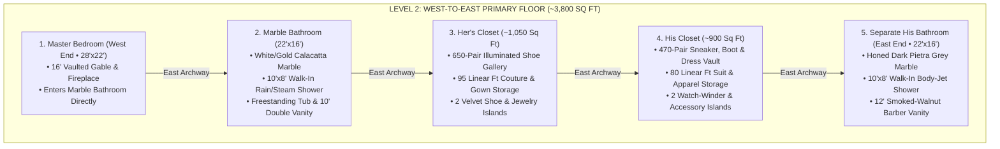
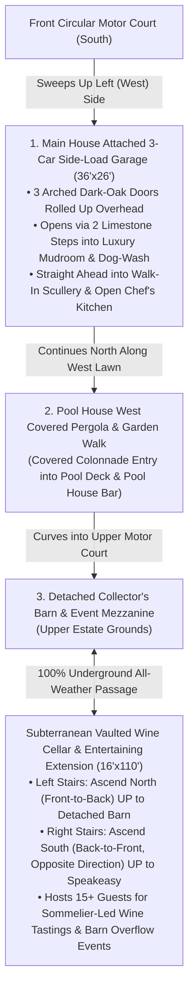

# Architect's Specification Sheet, Dual Closet Elevations & Outbuildings Plan

This specification document expands your approved main-residence concept to incorporate your exact layout preferences:
1. **Two Completely Separate His & Hers Closet + Shoe Suites** on Level 2 (each connected directly to its own opposite-side spa bathroom).
2. **Hidden Speakeasy Entry Inside the Walk-In Scullery / Butler's Pantry** on Level 1.
3. **Room-by-Room Architectural Finishes, Appliances & Mechanical Specifications.**
4. **Interior Design for the Pool House Pavilion, East Breezeway Wing, and Detached Barn** seen in your aerial photograph.

````carousel

<!-- slide -->

<!-- slide -->

<!-- slide -->

<!-- slide -->

<!-- slide -->
![Living Room View from the Soaring Great Room (15-Foot Open Separation from @builtbycarlene-Style Kitchen & Looking Toward the Front Door — 100% Unified Deep Dark Cherry / Mahogany Kitchen Cabinetry): Grand arched wrought-iron front door overlooking the circular cobblestone motor court in the background, a wide 15-foot open European white-oak floor promenade separating the Living Room furniture (cream slipcovered linen sofa, dark brown leather club armchairs, rustic wood coffee table on vintage rug) from the Open-Concept Chef's Kitchen on the right crafted 100% in deep dark cherry / mahogany wood cabinetry (22-foot Calacatta Verde/Viola green-and-burgundy veined marble slab island, deep dark cherry / mahogany base with LED toe-kick, 6 cream upholstered stools, tiered fluted-glass drum chandeliers & matching dark cherry / mahogany Oyster Raw Bar & Damascus Knife Vault column), with the carved French limestone fireplace, 85-inch TV, and curved Grand Staircase on the left.](/home/brianvinson/.gemini/jetski/brain/96883fd9-49e4-474d-86a1-0423e4655f3f/kitchen_v6_01a_living_room_exact_matched_dark_cherry_mahogany_1792712008630.jpg)
<!-- slide -->
![Large Open-Concept Chef's Kitchen in the @builtbycarlene Instagram Video Style (36'×26' with Monumental 22-Foot Calacatta Verde/Viola Marble Slab Island, Tiered Ribbed-Glass Drum Chandeliers, 100% Unified Deep Dark Cherry / Mahogany Wood Cabinetry, 32°F–34°F Chilled Oyster Raw Bar Vitrine & Built-In China Cabinet Secret Door to the Speakeasy): Features a 22-foot Calacatta Verde/Viola green-and-burgundy veined marble slab island over a deep dark cherry / mahogany drawer base with oversized horizontal brushed-brass pulls, glowing LED toe-kick, and 6 cream split-back upholstered stools under tiered fluted-glass & brass drum chandeliers, paired with matching deep dark cherry / mahogany tall cabinetry (housing the 32°F–34°F Chilled Oyster Raw Bar Vitrine & Damascus Knife Vault), sleek matte-black tapered range hood, deep dark cherry / mahogany glass-front upper & lower stove cabinets, 60" black-and-brass range, and the built-in illuminated deep dark cherry / mahogany China Cabinet Secret Door at the far end of the kitchen wall.](/home/brianvinson/.gemini/jetski/brain/96883fd9-49e4-474d-86a1-0423e4655f3f/kitchen_v6_01_great_room_exact_matched_dark_cherry_mahogany_1792711929120.jpg)
<!-- slide -->

<!-- slide -->

<!-- slide -->
![Inside the Hidden Speakeasy Looking Out the Open Door Into the Kitchen Toward the Back Door, Pool & Wellness Center at Nighttime: Single Flat Straight Wall Extending Continuously from the Back Pool Entrance Through the Tall Rectangular Deep Dark Cherry / Mahogany Doorway Frame All the Way to the Wine-Cellar Stairs and Wrought-Iron Stair Railing, with the China Cabinet Door Hinged on the Right (Stair-Side) Jamb Swinging Outward Into the Kitchen (Showing Only Its Solid Dark Cherry / Mahogany Paneled Wood Back, Matching View B from the Kitchen), and View From the Open Door Into the Kitchen Showing Only the Kitchen's Tall Black-Steel Back Door and Nighttime Pool Scenery with the Two-Story Wellness Center Glowing in the Background.](/home/brianvinson/.gemini/jetski/brain/96883fd9-49e4-474d-86a1-0423e4655f3f/speakeasy_v30_03_straight_wall_to_stairs_china_cabinet_swing.jpg)
<!-- slide -->
![Front-Left Wing "Mad Men" Executive Office & Library: 14-foot vaulted dark walnut beamed ceiling with brass Sputnik chandelier, carved French limestone fireplace with a flush-mounted 4K flat-screen TV recessed into the stone overmantel above, unobstructed oiled American black walnut bookcases (no ladder) & built-in crystal whiskey decanter bar, floating-top mid-century walnut & brass executive desk with Eames Time-Life chair, Eames Lounge Chair & Ottoman, and black steel windows framing the circular driveway and boxwood hedge maze.](/home/brianvinson/.gemini/jetski/brain/96883fd9-49e4-474d-86a1-0423e4655f3f/executive_office_mad_men_tv_no_ladder_jpg_1792692939300.jpg)
<!-- slide -->

<!-- slide -->

<!-- slide -->

<!-- slide -->

<!-- slide -->

<!-- slide -->

<!-- slide -->
![Detached 3-Bedroom Guest House Level 1 (Lenny Kravitz Paris Hôtel Particulier Maximalism — Cascading Murano Chandelier, Fluted Smoked-Walnut & Backlit Amber Kitchen, Zebra-Hide & Moroccan Rugs, Leopard Velvet Pillows, Vintage Les Paul Guitar, Single Straight-Run Staircase & Upper Mezzanine Glass-Surrounded Office): Monumental cascading 1970s Murano smoked-amber glass & brass chandelier, fluted smoked-walnut & backlit amber-glass Chef's Kitchen with 10-foot Nero Marquina marble waterfall island, cognac leather pit sectional layered with leopard velvet pillows & cream shearling throw over zebra-hide & Moroccan rugs, vintage Gibson Les Paul guitar on brass stand, carved West African sculptures, single straight-run floating walnut staircase, and upper-left 100% glass-surrounded "Boss Woman" Office.](/home/brianvinson/.gemini/jetski/brain/96883fd9-49e4-474d-86a1-0423e4655f3f/guest_house_v7_maximalist_level1_perfect_1792710442813.jpg)
<!-- slide -->
![Detached 3-Bedroom Guest House Level 2 View A (Lenny Kravitz Paris Hôtel Particulier Maximalism — Single Straight-Run Stairs, Brass-Framed B&W Rock Gallery Wall, Carved African Masks, Vinyl Record Console & 100% Glass-Surrounded "Boss Woman" Office on Right): Single straight-run floating walnut staircase arriving on a flat smoked-walnut herringbone mezzanine balcony beneath charcoal-espresso Venetian plaster walls curated with brass-framed B&W rock photography & carved African masks, cascading Murano smoked-amber glass chandelier, burl-wood vinyl record console, and the 100% glass-surrounded "Boss Woman" Executive Office on the right (burl-wood desk in the middle, cream bouclé chair behind desk facing away from wall).](/home/brianvinson/.gemini/jetski/brain/96883fd9-49e4-474d-86a1-0423e4655f3f/guest_house_v7_maximalist_level2_view_a_1792710125646.jpg)
<!-- slide -->
![Detached 3-Bedroom Guest House Level 2 View B (Lenny Kravitz Paris Hôtel Particulier Maximalism — 180° Reverse Angle Looking Back at the Single Straight-Run Stairs, 85-Inch TV & Vinyl Turntable Wall, and 100% Glass-Surrounded "Boss Woman" Office on Left): Shows the single straight-run floating walnut staircase descending straight down into the double-height living room below, the 85-inch flat-screen TV wall with burl-wood vinyl turntable credenza, brass-framed B&W rock portraits & vintage Gibson Les Paul guitar, and the exact same 100% glass-surrounded "Boss Woman" Executive Office on the left.](/home/brianvinson/.gemini/jetski/brain/96883fd9-49e4-474d-86a1-0423e4655f3f/guest_house_v7_maximalist_level2_view_b_1792710145597.jpg)
<!-- slide -->

<!-- slide -->

<!-- slide -->
![Detached Collector's Barn — Daily Collector Mode (4-Vehicle All-Black Fleet in an Angled Row Against the Left Wall, Zero Lift/Platform, Upstairs Event Bar & VIP Lounge Mezzanine, Sunlit Windowed Side Space & Subterranean Wine Cellar Stairs Directly Underneath the Upstairs Stairs): All 4 all-black vehicles (Jet-Black Porsche Panamera, Black Tesla Model Y, Matte-Black Tesla Cybertruck, and Matte-Black GMC Hummer EV) backed in against the left wall and angled in a single continuous row directly on the flat stone floor (zero car lift or platform), with the subterranean wine cellar stairwell descending straight DOWN (-12' below floor level) directly UNDERNEATH the floating white-oak stairs that lead upstairs, the Windowed Side Space on the right, and the Upstairs Event Mezzanine (VIP Bouclé Lounge on Left, DJ/Sound Overlook in Center & Full Backlit Bar on Right).](/home/brianvinson/.gemini/jetski/brain/96883fd9-49e4-474d-86a1-0423e4655f3f/collectors_barn_v6_black_fleet_4cars_angled_row_under_stairs_wine.jpg)
<!-- slide -->
![Detached Collector's Barn — Event Conversion Option 1 (Luxury Wedding Ceremony & Candlelit Banquet Reception, Cars Moved Out & Wine Cellar Stairs Directly Underneath Upstairs Stairs): Exact same architectural view with all vehicles moved out—featuring white Belgian-linen banquet tables, gold velvet chairs, cascading white rose & hydrangea floral runners, crystal empire chandeliers & fairy-light garlands on the timber trusses, live band stage, Upstairs Event Mezzanine (VIP Bridal Lounge on Left, Wedding DJ/Sound Booth in Center & Full Backlit Champagne Bar on Right), the Windowed Side Space on the right, and the subterranean wine cellar stairs descending straight DOWN directly UNDERNEATH the floating white-oak stairs that lead upstairs.](/home/brianvinson/.gemini/jetski/brain/96883fd9-49e4-474d-86a1-0423e4655f3f/collectors_barn_v6_wedding_reception_under_stairs_wine_cellar.jpg)
<!-- slide -->
![Detached Collector's Barn — Event Conversion Option 2 (Evening Special Occasion, Black-Tie Gala & Craft Cocktail Lounge, Cars Moved Out & Wine Cellar Stairs Directly Underneath Upstairs Stairs): Exact same architectural view in twilight gala configuration—featuring tiered concentric brass ring chandeliers, tufted emerald velvet & cognac leather Chesterfield lounge seating over Persian rugs, marble high-top cocktail tables, dance floor & live jazz stage at the rear, Upstairs Event Mezzanine (VIP Gala Lounge on Left, DJ/Sound Booth in Center & Full Backlit Mixology Bar on Right), the Windowed Side Space outfitted with a glowing marble cocktail bar, and the subterranean wine cellar stairs descending straight DOWN directly UNDERNEATH the floating white-oak stairs that lead upstairs.](/home/brianvinson/.gemini/jetski/brain/96883fd9-49e4-474d-86a1-0423e4655f3f/collectors_barn_v6_special_event_gala_under_stairs_wine_cellar.jpg)
<!-- slide -->

<!-- slide -->
![Attached 3-Car Side-Load Garage Interior (Doors Rolled Up, Without Cars Inside): Empty honed dark charcoal-slate 3-bay showroom floor, all three arched dark-oak carriage doors lifted overhead on high-lift black-steel ceiling tracks framing the sunlit cobblestone driveway and wisteria pergola outside, three Universal EV Fast Chargers & custom walnut tool cabinetry on the back wall, and two limestone steps on the right leading through wide-open dark-oak & glass French doors directly into the Luxury Mudroom, Dog-Wash Station, Butler's Scullery & Open Chef's Kitchen.](/home/brianvinson/.gemini/jetski/brain/96883fd9-49e4-474d-86a1-0423e4655f3f/attached_3car_garage_interior_doors_up_mudroom_entry.jpg)
````

---

## 1. Level 2 Primary Floor: Strict West-to-East 5-Room Linear Flow (`Bedroom ➔ Marble Bathroom ➔ Her's Closet ➔ His Closet ➔ Separate His Bathroom with Walk-In Shower`)

The entire second floor (`~3,800 Sq Ft`) is arranged in an unbroken **West-to-East** progression so each space flows logically into the next, while also connecting to the **Grand Staircase Gallery Bridge & Laundry Valet** along the south mezzanine corridor:

`[1. Master Bedroom (West End)] ➔ [2. Marble Bathroom ("Her's" Calacatta Gold Spa)] ➔ [3. Her's Closet (650-Pair Shoes & Couture)] ➔ [4. His Closet (470-Pair Sneakers & Suits)] ➔ [5. Separate His Bathroom with Walk-In Shower (Far East End)]`



### Vertical Millwork Elevation for the 1,000+ Pair Shoe Walls (10'0" / 120" Cabinet Height)

To store **1,120 pairs of shoes** across the two separate suites (`650 pairs` in West Suite 1 + `470 pairs` in East Suite 2) with museum-quality presentation:

| Vertical Zone (Height Above Finished Floor) | Tier / Function | Clear Height × Depth | Details & Hardware |
| :--- | :--- | :--- | :--- |
| **`106" – 120"` (Top 14")** | **Display Box & Seasonal Loft** | `14" H × 16" D` | Houses original collector boxes (Chanel, Hermès, Louis Vuitton, rare sneaker boxes) with integrated up-lighting. |
| **`92" – 106"` (Tiers 9 & 10)** | **Ladder-Access Evening / Collector Tiers** | `7" H × 14" D` (×2 tiers) | Accessed via **Putnam solid unlacquered brass rolling library ladders** on a continuous `92" AFF` perimeter rail. |
| **`28" – 92"` (Tiers 2 to 8)** | **Primary Eye-to-Waist Shoe Display (7 Tiers)** | `8.5" H × 14" D` (adjustable) | **West Suite:** 12° angled walnut shelves with recessed solid brass heel stops and anti-slip leather inlays.<br>**East Suite:** Flat smoked-oak shelves with tempered glass fronts and 3000K CRI-97 recessed LED channels. |
| **`4" – 28"` (Tier 1 / Boot Bay)** | **Tall Boot & High-Top Sneaker Base Tier** | `16"–22" H × 15" D` | Sized for knee-high riding/fashion boots (with internal cedar boot shapers) and high-top collector sneakers. |
| **`0" – 4"` (Toe Kick)** | **Illuminated Floating Plinth** | `4" H` recessed | Motion-activated warm LED toe-kick ribbon + concealed HVAC return slots for **48% RH leather preservation**. |

---

## 2. Level 1 Refinement: Secret Built-In Illuminated China Cabinet Door Opening Towards the Kitchen Area

Disguising the Speakeasy entrance as a **full-height, built-in illuminated glass-front China Cabinet at the far end of the `@builtbycarlene` kitchen wall that opens outward TOWARDS the kitchen area** creates an unforgettable architectural reveal: when closed, guests see a museum-lit china hutch filled with fine white porcelain dinnerware and crystal stemware; when triggered, the entire china cabinet pivots outward towards the kitchen to reveal the glowing antique-brick arches of the Hidden Speakeasy Bar.

```mermaid
flowchart LR
    Kitchen["@builtbycarlene Open Chef's Kitchen\n• 32°F Oyster Raw Bar & Knife Vault\n• 60\" Range & Matte-Black Tapered Hood\n• 22' Calacatta Verde/Viola Island"] -->|"Far End of Kitchen Wall"| ChinaCab["Built-In Illuminated China Cabinet\n• Displays Porcelain China & Crystal\n• Swings Outward TOWARDS Kitchen Area"]
    ChinaCab -->|"Heavy-Duty Concealed Pivot/SOSS Hinges\n(Hidden Magnetic Release)"| Speakeasy["Hidden Speakeasy Bar (18'x14')\n• High Center-Brick TV & 2 Liquor Arches\n• Wall-Connected Stair Rail to Wine Tunnel"]
    Speakeasy -.->|"Black-Steel French Doors"| PoolDeck["Rear Pool Courtyard Terrace"]
```

- **How the Secret Dark Cherry / Mahogany China Cabinet Door Works (Opening Outward Towards the Kitchen Area):**
  - **Visual Disguise & Shelf Stabilization:** Built flush at the north end of the kitchen cabinetry wall beside the 20-foot black-steel window, the floor-to-ceiling **rich dark cherry / mahogany China Cabinet** features mullioned glass doors, warm 2700K vertical LED shelf strips, and museum-grade clear acrylic/silicone gallery rail lips & micro-suction pads so every porcelain plate, bowl, tureen, and crystal stem stays 100% secure while the cabinet swings.
  - **Outward Swing Towards the Kitchen Area:** Engineered on a **Ritson/FritsJurgens heavy-duty concealed structural pivot system (rated to 1,100 lbs)** and concealed SOSS hinges, releasing the hidden magnetic latch allows the entire dark cherry / mahogany China Cabinet to swing smoothly **outward towards the kitchen aisle**, never encroaching on the Speakeasy interior or the wine-tunnel stair rail.
  - **Acoustic & Smoke Isolation:** The cabinet perimeter incorporates **Pemko acoustic compression seals** and an automatic mortised drop-bottom seal (`STC-55`), keeping the speakeasy completely soundproofed when closed.

---

## 3. Architect's Room-by-Room Finish, Fixture & Appliance Specification Sheet

### A. Large Open-Concept Chef's Kitchen (`36' × 26'`) — Unified Dark Cherry / Mahogany Wood Cabinetry, 22-Foot Calacatta Verde/Viola Slab Island, Walk-In Scullery & Recommended Elite Chef Upgrades
| Category | Recommended Specification | Architectural Notes |
| :--- | :--- | :--- |
| **Open-Concept Volume & 15' Separation** | **`36' × 26'` Palatial Open-Concept Kitchen** + **`15'-Wide` Open European White-Oak Gallery Separation from Living Room** | Expands the kitchen footprint and establishes a generous 15-foot open hardwood circulation promenade between the 22-foot Kitchen Island and the Living Room sofa/chairs so the two spaces feel airy and uncrowded. |
| **`@builtbycarlene` 22-Foot Stone Slab Island & Lighting** | **Monumental `22' × 5'` Clutter-Free Polished Calacatta Verde / Calacatta Viola Marble Slab Island** + **Rich Dark Cherry / Mahogany Drawer Base w/ Horizontal Brushed-Brass Pulls & LED Toe-Kick** + **Tiered Ribbed-Glass & Brass Drum Chandeliers** | Inspired by Carlene Sarpong's (`@builtbycarlene`) kitchen design: creamy alabaster-white Italian marble slab with dramatic brecciated **sage-emerald green, deep burgundy-plum, and warm gold veining** and stepped edge profile, paired with **6 plush cream/champagne channel-split-back upholstered counter stools** and **3 cylindrical two-tier fluted/ribbed glass & brushed-brass drum chandeliers**. |
| **Unified Dark Cherry / Mahogany Custom Millwork** | **100% Matching Rich Dark Cherry / Mahogany Cabinetry Across Oyster Raw Bar Column, Stove Area, Island Base & Built-In China Cabinet Speakeasy Door** | All wooden cabinetry across the kitchen—including the 32°F–34°F Oyster Raw Bar & Damascus Knife Vault column, upper glass-front & lower drawer cabinets around the 60" stove, the 22-foot island base, and the built-in China Cabinet Speakeasy door—is crafted in the same rich dark cherry / mahogany stained wood. |
| **Professional Gas-Top Range & Pot Filler** | **60" Wolf Pro Dual-Fuel Range** (`DF60650CG`) *or* **La Cornue Château 150** + **Articulated Brass Pot Filler** | 6 to 8 high-BTU sealed/open gas burners + infrared charbroiler + French top plaque; wall-mounted unlacquered brass pot filler centered over the burners. |
| **2 Built-In Wall Ovens + Built-In Microwave** | **30" Wolf M-Series Convection Oven** + **30" Wolf Convection Steam Oven** (stacked right of range) + **24" Wolf Built-In Stainless Drawer/Drop-Down Speed Microwave** (in mahogany base cabinet left of range) | Gives you 4 full oven cavities plus a flush built-in stainless microwave at ergonomic counter height. |
| **6-Foot Trough Sink (In 22-Foot Island)** | **72" × 20" Custom Carved Dark Marble or Brushed Brass/Stainless Workstation Trough Sink** | Set into the 22-foot dark veined marble waterfall island; outfitted with **2 Waterworks Henry unlacquered brass bridge faucets**, 2 high-pressure glass rinsers, and sliding walnut/marble prep boards. |
| **Elite Upgrade 1: Integrated Culinary Modules** | **Gaggenau 400 Series Teppanyaki + Induction Wok Module + Sous-Vide Vacuum Sealer & Warming Drawers** | Flush-mounted beside the range or in the island prep zone, paired with a built-in vacuum-sealing drawer for sous-vide and two warming drawers to hold plates at 140°F. |
| **Elite Upgrade 2: Chilled Oyster Raw Bar Vitrine, Knife Vault & Espresso Program** | **32°F–34°F Chilled Oyster Raw Bar & Sashimi/Caviar Vitrine** + **Magnetic Damascus & Oyster-Shucking Knife Vault** + **Steamed Oshibori Towel Drawer** + **Plumbed Miele Espresso System** + **Zip Water HydroTap** | Replaces a redundant main-kitchen wine fridge (since 2,000+ bottles are in the underground Wine Tunnel) with a commercial-grade `32°F–34°F` forced-air & humidity-controlled (`85%–90% RH`) Chilled Oyster Raw Bar Vitrine featuring plumbed self-draining crushed-ice pans for fresh oysters on the half shell, lemon wedges, mignonette/cocktail cruets, and caviar, plus a magnetic Damascus knife vault, hot steamed towel drawer, direct-plumbed espresso bar, and boiling/chilled/sparkling water tap at the 6' trough sink. |
| **Elite Upgrade 3: Commercial Scullery & Dish Care** | **3 Dishwashers Total:** Dual Miele Knock-to-Open Dishwashers flanking the 6' Island Trough Sink + **Hobart/Miele Professional 90-Second High-Temp Sanitizing Dishwasher** in the Scullery | Ensures zero glassware or cookware buildup during large dinners, plus a walk-in **40°F Cold Room / Produce Pantry** and **Scotsman Nugget + Clear Craft Ice Makers**. |
| **Elite Upgrade 4: Wood-Fired Hearth / Rotisserie & Herb Wall** | **Built-In La Cornue Flamberge Gas Rotisserie** + **Recessed UV-Lit Living Culinary Herb Trough** | Flush-mounted wall rotisserie for restaurant-grade roast meats/poultry and a self-watering microgreen/herb channel integrated into the marble backsplash. |

### B. Level 2 Primary Bathrooms (Both Equipped with Custom `88" × 48" × 26"` Two-Person Soaking Tubs Sized for 6'8" Height)
| Category | Step 2: Her's Calacatta Gold Marble Bathroom (`24' × 18'`) | Step 5: Separate His Dark Pietra Grey Marble Bathroom (`24' × 18'`) |
| :--- | :--- | :--- |
| **Oversized `88" × 48" × 26"` (`7.3-Foot`) Two-Person Tub (Sized for 6'8" Height)** | **Custom Carved Calacatta Gold Marble / Cast-Stone Two-Person Soaking Tub (`88" L × 48" W × 26" Deep`):** Engineered for a 6'8" frame and two bathers reclining face-to-face or side-by-side, with dual ergonomic sloped backrests, two opposing waterproof headrests, inline constant-temperature water heater, and floor-mounted brushed-brass filler. | **Custom Honed Charcoal Pietra Grey Marble Two-Person Soaking & Hydrotherapy Tub (`88" L × 48" W × 26" Deep`):** Centered beneath the east gable window and proportioned for your 6'8" height and two bathers, with dual sloped backrests, two dark leather waterproof headrests, warm under-plinth LED glow, and dark platinum floor-mounted filler. |
| **10' × 8' Walk-In Shower Envelope** | Book-matched **Calacatta Gold marble slabs** with 3/8" Starphire low-iron frameless glass enclosure on the right wall. | Honed **Pietra Grey dark veined marble slabs** with blackened-steel & glass walk-in shower enclosure on the left wall. |
| **Shower Hydrotherapy & Steam** | **Dornbracht MEM Brushed Brass:** Dual 16" ceiling rain showers, 4 vertical body sprays, handheld wand, and **Mr.Steam Super3e** generator with AromaSteam & ChromaSteam. | **Dornbracht MEM Dark Platinum:** Dual 16" ceiling rain showers, 6 high-output hydrotherapy body jets, handheld wand, and zero-threshold **Schluter Kerdi-Line** drain. |
| **Vanity & Architectural Ceiling** | `10'0"` custom fluted oak double vanity on the left wall, groin-vaulted plaster ceiling with clerestory window, and **NuHeat hydronic floor heating**. | `12'0"` floating smoked-walnut & dark stone barber/grooming double vanity on the right wall under **pitched dark smoked-oak timber rafters** with radiant heated floors. |

### C. "Mad Men" Executive Office & Vintage Velvet Couch Theater Room (West Wing)
| Space | Architectural Finishes & Millwork | Audio / Visual & Lighting Systems |
| :--- | :--- | :--- |
| **"Mad Men" Executive Office (`18' × 16'`)** | • Hand-carved French limestone mantel on the left wall + **flush-mounted 4K flat-screen TV recessed into the stone overmantel above**.<br>• Dark walnut herringbone parquet floors & floor-to-ceiling oiled American black walnut bookcases (**no rolling ladder**—sized for your 6'8" reach) + crystal whiskey decanter bar.<br>• Floating walnut & brass desk with Eames Time-Life chair & Eames Lounge Chair. | • **Lutron HomeWorks QS** motorized solar & drapery shades on the steel casement windows.<br>• Concealed ceiling array microphone & 4K camera hidden in bookcase molding for executive video calls. |
| **Dedicated Snuggle Theater (`22' × 18'`)** | • **Two Tiered Stadium Rows of Deep Burgundy Velvet Snuggle Couches (`48"` seat depth) BOTH Facing Straight Toward the Screen:** Front-row channel-tufted deep burgundy/merlot velvet snuggle couch with twin chaise extensions positioned **closer to the 150-inch movie screen** on the lower level, and second-row button-tufted deep burgundy/merlot velvet snuggle couch with twin chaises elevated on the stadium riser behind it—both parallel to and facing dead-on straight at the screen.<br>• Dark navy acoustic velvet wall panels with bronze LED sconces + fiber-optic starlight coffered ceiling. | • **150" Stewart Filmscreen** acoustically transparent 2.35:1 CinemaScope screen.<br>• **Sony Bravia Projector 9 (VPL-XW8100ES)** 4K laser projection in a hushed rear projection closet.<br>• **Dolby Atmos 9.4.6** concealed speaker system (Triad Gold/Meyer Sound) with 4 manifold subwoofers built into the riser. |

---

## 4. Interior Design for the 3-Bedroom Detached Guest House (Lenny Kravitz × CB2 Style with 100% Fully Glass-Enclosed Boss Woman Office), Two-Story Wellness / Health Facility & Detached Barn

Your reference photograph includes three remarkable secondary structures behind the main house that turn the property into a private resort compound:

```mermaid
flowchart TD
    Main["Main Residence Rear Veranda"] --> Pool["Central Courtyard Swimming Pool & Sun Shelf"]
    Pool --> GuestHouse["1. Two-Story 3-Bedroom, 2-Bathroom Guest House (~2,800 Sq Ft • Lenny Kravitz × CB2 Style)\n• Level 1: Smoked-Walnut & Nero Marquina Kitchen, Cognac Leather/Bouclé Lounge, Bed #1 & Bath #1\n• Level 2: 100% Fully Glass-Enclosed 'Boss Woman' Office, Bedrooms #2 & #3 + Full Bath #2"]
    GuestHouse <-->|"Covered Breezeway"| Wellness["2. Two-Story Wellness / Health Facility (~1,600 Sq Ft)\n• Level 1: Bubbling Hot Tub, Cedar Sauna & Open Shower Area (Opens to Pool)\n• Level 2: Workout Facility w/ Large 85\" TV + Complete Upstairs Full Bathroom"]
    GuestHouse -.->|"Lawn Drive"| Barn["3. Detached Collector's Barn (~2,800 Sq Ft)\n• Level 1: 4-Vehicle All-Black Fleet Auto Gallery & Tunnel Stairs\n• Level 2 Loft: Billiards, Poker & Bourbon/Cigar Lounge"]
```

### 1. Two-Story 3-Bedroom, 2-Bathroom Detached Guest House (`~2,800 Sq Ft`, Lenny Kravitz Paris *Hôtel Particulier* & Kravitz Design × CB2 Rock-and-Roll Maximalism — Straight-Up Stairs & 100% Glass-Surrounded "Boss Woman" Office)

![Detached Guest House Level 1 (Lenny Kravitz Paris Hôtel Particulier Maximalism) — Monumental Cascading 1970s Murano Smoked-Amber Glass & Brass Chandelier, Fluted Smoked-Walnut & Backlit Amber-Glass Chef's Kitchen with 10-Foot Nero Marquina Marble Waterfall Island, Cognac Leather Sectional Layered with Leopard Velvet Pillows & Cream Shearling Throw over a Zebra-Hide & Moroccan Rug, Burl-Wood Plinth Coffee Table, Vintage Gibson Les Paul Guitar on Brass Stand, Carved African Totemic Sculptures, Single Straight-Run Floating Walnut Staircase, and Upper-Left 100% Glass-Surrounded "Boss Woman" Office](/home/brianvinson/.gemini/jetski/brain/96883fd9-49e4-474d-86a1-0423e4655f3f/guest_house_v7_maximalist_level1_perfect_1792710442813.jpg)

![Detached Guest House Level 2 View A (Lenny Kravitz Paris Hôtel Particulier Maximalism) — Single Straight-Run Floating Walnut Staircase Arriving on the Smoked-Walnut Herringbone Mezzanine Balcony Beneath Charcoal-Espresso Venetian Plaster Gallery Walls Curated with Brass-Framed B&W Rock Photography & Carved African Masks, Cascading Murano Smoked-Amber Glass Chandelier in the Double-Height Void, Burl-Wood Vinyl Record Console, and the 100% Glass-Surrounded "Boss Woman" Office on the Right (Burl-Wood Desk in Middle, Cream Bouclé Chair Behind Desk Facing Away from Wall, Layered Persian Rug & Leopard-Pillow Cognac Lounge Chair)](/home/brianvinson/.gemini/jetski/brain/96883fd9-49e4-474d-86a1-0423e4655f3f/guest_house_v7_maximalist_level2_view_a_1792710125646.jpg)


- **Lenny Kravitz Paris *Hôtel Particulier* & Kravitz Design × CB2 Rock-and-Roll Maximalism:** Dialed up to full soulful rock-star maximalism inspired by Lenny Kravitz's Paris residence in *Architectural Digest*—featuring:
  - **Monumental 1970s Murano Chandelier & Backlit Amber Cabinetry:** A dramatic **multi-tiered cascading 1970s Italian Murano smoked-amber glass & brushed-brass chandelier** suspended through the double-height living room void (complementing the smoked-glass Sputnik chandelier over the 10-foot Nero Marquina marble waterfall island and **warm amber-lit glass upper display cabinets** in the fluted smoked-walnut kitchen).
  - **Charcoal-Espresso Venetian Plaster Gallery Walls & Tribal Art:** Hand-troweled **moody charcoal-espresso Venetian plaster walls** curated with **oversized brass-framed black-and-white rock-and-roll photography** (Jimi Hendrix, Miles Davis, Prince) alongside **museum-mounted hand-carved West African tribal masks and tall totemic wood sculptures**.
  - **Layered Exotic Textiles & Animal Prints:** A **graphic zebra-hide rug layered diagonally over the oversized vintage black-and-cream Moroccan wool rug**, plus **leopard-print velvet pillows, deep oxblood velvet cushions, and a plush cream Mongolian shearling throw** draped across the channel-tufted cognac leather pit sectional.
  - **Rock-Star Instruments, Vinyl & Brutalist Brass Accents:** A **vintage sunburst Gibson Les Paul electric guitar on a brass stand** beside the dark stone fireplace, a **Paul Evans–inspired brutalist brass floor lamp**, a **heavy burl-wood plinth coffee table** stacked with oversized Taschen music/art monographs and brass candleholders, and a **burl-wood & brass audiophile vinyl record credenza with turntable** on Level 2.
- **Consistent Single Straight-Run Staircase (Goes Straight Up, Zero Wrap-Around Across All 3 Pictures):** Across Level 1, Level 2 View A, and Level 2 View B, the floating dark-walnut staircase with frameless glass balustrade rises **100% straight up in a single unbroken straight flight (no wrap-around, no turns)** along the side of the double-height living room to the flat, single-level smoked-walnut herringbone mezzanine balcony.
- **Large 100% Glass-Surrounded "Boss Woman" Video-Conference Executive Office Overlooking the Main Part of the House (`18' × 15'`, Consistent Across All 3 Pictures):** Completely enclosed on **all interior sides** in sound-insulated **floor-to-ceiling matte-black architectural steel-and-glass grid partitions (`STC-48`)** with double French glass doors, positioned on the Level 2 mezzanine so it **directly overlooks the main double-height living room and kitchen of the Guest House below AND looks out through the soaring two-story black-steel gable window across the swimming pool toward the Main Residence**. Inside, the **sculptural burl-wood & brass executive desk sits in the middle of the office** (over a layered vintage Persian & zebra-hide rug), the **cream bouclé & brass executive swivel chair sits behind the desk facing away from the back wall**, and a **channel-tufted cognac leather lounge chair with a leopard velvet pillow** sits beside the illuminated **fluted smoked-walnut arched "Zoom Power Backdrop" wall**.
- **Complete 3-Bedroom, 2-Bathroom Guest House Program + Full Kitchen & 85-Inch TV:** Level 1 houses the **fluted smoked-walnut & Nero Marquina marble Chef's Kitchen**, **maximalist cognac leather & zebra/Moroccan Fireside Living Room**, **Downstairs Guest Bedroom #1**, and **Downstairs Full Bathroom #1**; Level 2 houses **Upstairs Guest Bedrooms #2 & #3**, **Upstairs Full Bathroom #2**, and the **85-inch 4K TV wall with burl-wood vinyl turntable console**.

### 2. East Breezeway Building: Two-Story Wellness / Health Facility (`~1,600 Sq Ft`, Connected to the Right of the Pool)


- Linked to the Guest House via the covered breezeway visible in your photo, this two-story gabled **Wellness / Health Facility** is dedicated to hydrotherapy downstairs and athletic performance upstairs:
  - **Level 1 — Hydrotherapy Hot Tub, Finnish Cedar Sauna & Walk-Through Open Shower Area Opening Directly to the Pool (`~850 Sq Ft`):** Features three tall black-steel doors folded wide open directly to the outdoor pool area, a sunken **bubbling heated stone Hot Tub** (plus 39°F cold plunge) in the center, a glass-front **Finnish cedar dry sauna** on the left, a **walk-through Open Shower Area** (open fluted travertine wet-deck with overhead brass rain shower, body jets, and backlit towel niche—no glass door) right beside the sauna, and the **floating white-oak & blackened-steel staircase ascending directly to the Workout Facility above**.
  - **Level 2 — Workout Facility with Large 85-Inch Flat-Screen TV & Complete Upstairs Full Bathroom (`~750 Sq Ft`):** Directly above the Sauna and Hot Tub under vaulted whitewashed oak scissor trusses, featuring a **flush-mounted 85-inch 4K flat-screen TV on the right plaster wall** above the stairs, **two indoor spinning bikes**, pool-facing commercial slat-belt treadmills, walnut Reformer Pilates carriage, a **matte-black Bench Press station and adjustable dumbbell rack in the back-left corner**, a recessed travertine **Hydration & Towel Bar**, AND a **complete Upstairs Full Bathroom** in the rear-right corner (with floating Calacatta marble vanity, backlit mirror, private toilet alcove, and glass-enclosed walk-in rain shower).

### 3. Detached Collector's Barn & Multi-Purpose Special Events / Wedding Pavilion (`~3,250 Sq Ft` Total Including the Windowed Side Space & Level 2 Event Bar / VIP Lounge Mezzanine)

#### Mode A — Daily Collector Gallery with All 4 All-Black Cars Backed In & Angled in a Single Row (No Lift/Platform), 5 Circular LED Ring Lights, Single Rear Bathroom Door, Unobstructed Full-Length Floating Stairs to the Floor & Wine Cellar Stairs Tucked Beneath the Upper Span
![Detached Collector's Barn (Daily Collector Mode v8) — All 4 All-Black Vehicles (Jet-Black Porsche Panamera, Black Tesla Model Y, Matte-Black Tesla Cybertruck & Matte-Black GMC Hummer EV) Backed In Against the Left Wall and Angled in a Single Continuous Row on the Flat Stone Floor (Zero Lift or Platform), 5 Sleek Matte-Black Circular LED Ring Chandeliers on the Vaulted Timber Ceiling, Clean Rear Shiplap Wall with Only a Single Bathroom Entrance Door, Upstairs Event Mezzanine (VIP Bouclé Lounge on Left, DJ/Sound Overlook in Center & Full Backlit Bar on Right), Windowed Side Space on the Right, Unobstructed Full-Length Floating White-Oak Stairs All the Way to the Bottom Floor Step, and Subterranean Wine Cellar Stairs Tucked Directly BENEATH the Upper Span of the Floating Stairs (With No Cellar Door Showing)](/home/brianvinson/.gemini/jetski/brain/96883fd9-49e4-474d-86a1-0423e4655f3f/collectors_barn_v8_black_fleet.jpg)

#### Mode B (Event Option 1) — Enchanted Luxury Wedding Ceremony & Candlelit Banquet Reception (Exact Same View, Identical 5 Circular LED Ring Lights, Single Rear Bathroom Door, Unobstructed Full-Length Floating Stairs to the Floor & Wine Cellar Stairs Tucked Beneath Upper Span)
![Detached Collector's Barn (Event Conversion Option 1 v8 — Luxury Wedding Ceremony & Banquet Reception) — Exact Same View & Identical 5 Matte-Black Circular LED Ring Lights as the Garage Picture, Clean Rear Shiplap Wall with Only a Single Bathroom Entrance Door, White Belgian-Linen Banquet Tables with Gold Velvet Chairs & Cascading Floral Runners, Upstairs Event Mezzanine (VIP Bridal Lounge on Left, Wedding DJ/Sound Booth in Center & Full Backlit Champagne Bar on Right), Sunlit Windowed Side Space on the Right, Unobstructed Full-Length Floating White-Oak Stairs All the Way to the Bottom Floor Step, and Subterranean Wine Cellar Stairs Tucked Directly BENEATH the Upper Span of the Floating Stairs (With No Cellar Door Showing)](/home/brianvinson/.gemini/jetski/brain/96883fd9-49e4-474d-86a1-0423e4655f3f/collectors_barn_v8_wedding.jpg)

#### Mode C (Event Option 2) — Evening Special Occasion, Black-Tie Gala & Craft Cocktail Lounge (Exact Same View, Identical 5 Circular LED Ring Lights, Single Rear Bathroom Door, Unobstructed Full-Length Floating Stairs to the Floor & Wine Cellar Stairs Tucked Beneath Upper Span)
![Detached Collector's Barn (Event Conversion Option 2 v8 — Evening Special Occasion, Black-Tie Gala & Cocktail Lounge) — Exact Same View & Identical 5 Matte-Black Circular LED Ring Lights as the Garage Picture, Clean Rear Shiplap Wall with Only a Single Bathroom Entrance Door, Tufted Emerald-Green Velvet & Cognac Leather Chesterfield Lounge Groupings over Vintage Persian Rugs, Nero Marquina Marble High-Tops, Upstairs Event Mezzanine (VIP Gala Lounge on Left, DJ/Sound Booth in Center & Full Backlit Mixology Bar on Right), Windowed Side Space on the Right, Unobstructed Full-Length Floating White-Oak Stairs All the Way to the Bottom Floor Step, and Subterranean Wine Cellar Stairs Tucked Directly BENEATH the Upper Span of the Floating Stairs (With No Cellar Door Showing)](/home/brianvinson/.gemini/jetski/brain/96883fd9-49e4-474d-86a1-0423e4655f3f/collectors_barn_v8_gala.jpg)

- **Identical Architectural Ceiling Lighting Across All 3 Visuals:**
  - All three Barn modes (Mode A 4-Car Fleet, Mode B Wedding Reception, and Mode C Evening Gala) feature the **exact same 5 sleek matte-black circular LED ring chandeliers** suspended from the vaulted Douglas-fir timber trusses beneath the central ridge skylight.
- **Clean Rear Wall with Only a Single Bathroom Entrance Door:**
  - The back wall under the mezzanine is a clean, continuous white vertical shiplap wall with warm LED cove lighting and **no doors in the back except for a single sleek dark-oak / matte-black framed Bathroom Entrance Door** in the center.
- **Unobstructed Floating White-Oak Stairs All the Way to the Floor & Wine Cellar Stairs Tucked Beneath the Upper Span (With No Cellar Door Showing):**
  - Across all 3 visuals, the **floating white-oak open-riser staircase ascending along the right wall to the second level is 100% visible, solid, brightly lit, and completely unobstructed all the way down to the bottom floor step** on the dark charcoal basalt slab—never overshadowed or blocked near the bottom.
  - Tucked neatly **underneath the upper/middle span of the floating staircase** (where the floating white-oak treads have risen high overhead), warm LED-lit limestone steps descend straight **DOWN (`-12'` below floor level)** into the subterranean wine cellar & entertaining gallery, with **no cellar door showing** (since the cellar entrance sits at the bottom of the stairs).
- **All 4 All-Black Vehicles Backed In Against the Left Wall and Angled in a Single Continuous Row (Zero Lift / Platform):**
  - With **no car lift or platform**, all 4 vehicles in your all-black fleet sit directly on the polished dark charcoal stone slab floor **backed in against the left wall at a uniform ~45-degree showroom angle in a single continuous row**:
    1. **Front-Left Foreground:** **Jet-Black Porsche Panamera** (glossy black paint, black rims, dark tint).
    2. **Second in the Row:** **Black Tesla Model Y** (glossy black paint, black turbine wheels, dark tint).
    3. **Third in the Row:** **Matte-Black Wrapped Tesla Cybertruck** (stealth matte-black wrap, black wheels).
    4. **Fourth in the Row:** **Matte-Black GMC Hummer EV SUV** (matte-black finish, black off-road wheels).
- **Redesigned Level 2 Event-Hosting Mezzanine Loft (`~1,200 Sq Ft` — Full-Service Bar, VIP Lounge & DJ / Sound & Lighting Overlook):**
  - Purpose-built for weddings, black-tie galas, and private events (with the pool table completely removed):
    1. **Right Bay — Full-Service Architectural Event & Mixology Bar:** Warm amber-backlit multi-tier glass liquor & champagne display wall, fluted dark-walnut and brushed-brass bar counter with honed Calacatta marble top, under-counter chillers, and cognac-leather barstools.
    2. **Center Overlook — Integrated DJ, Acoustic Sound & Lighting Control Station:** Centered behind the frameless glass balustrade overlooking the entire main timber hall below.
    3. **Left Bay — VIP Bridal & Cocktail Lounge:** Curved cream bouclé and cognac-leather sectional sofa, velvet club chairs, and round brass-and-marble champagne tables.
- **Representing the Property Aerial View — Lower Shed-Roofed Side Space with Windows (`~450 Sq Ft`, `12' × 38'` Right Wing):**
  - Matching the exterior property aerial view of the Barn, the interior opens between heavy white-oak colonnade posts into a bright **Windowed Side Space** overlooking the green estate lawn and mature trees.
- **Architectural & Mechanical Event Conversion Specifications (`120–180 Seated Banquet Guests` / `250+ Cocktail Guests`):**
  - Equipped with a dedicated **400A 3-phase event power subpanel**, **concealed 1,000-lb rigging points** along the oak scissor trusses, and **high-capacity commercial VRF climate control** sized for 200+ guests.

---

## 5. Attached 3-Car Side-Load Garage (Exterior & Interior with Doors Up) & How It Opens Into the Main Home

Looking at the left (west) side of your aerial photograph, a continuous paved stone driveway sweeps from the front circular motor court all the way past the left wing of the main house, past the left pergola of the pool house, and directly into the motor court of the Detached Barn at the top of the property.



### A. Inside the Attached 3-Car Daily-Driver Garage (Doors Rolled Up, Zero Cars Inside) & What Room It Opens Into

![Attached 3-Car Side-Load Garage Interior (Doors Rolled Up, Without Cars Inside) — Empty Honed Dark Charcoal-Slate 3-Bay Showroom Floor, Three Arched Dark-Oak Carriage Doors Lifted Overhead on High-Lift Black-Steel Tracks Framing the Sunlit Cobblestone Driveway & Wisteria Pergola Outside, Three EV Fast Chargers & Custom Walnut Tool Cabinetry on the Back Wall, and Two Limestone Steps on the Right Leading Through Wide-Open Dark-Oak & Glass French Doors Directly Into the Luxury Mudroom, Dog-Wash Station, Butler's Scullery & Open Chef's Kitchen](/home/brianvinson/.gemini/jetski/brain/96883fd9-49e4-474d-86a1-0423e4655f3f/attached_3car_garage_interior_doors_up_mudroom_entry.jpg)

- **Showroom-Grade 3-Bay Interior with Doors Up (`36' × 26'` • Far-Left / West Wing):**
  - **All Three Arched Carriage Doors Rolled Up Overhead (Left Wall):** Three custom insulated dark-oak carriage doors lift horizontally on high-lift black-steel ceiling tracks beneath the 13-foot whitewashed oak-beamed ceiling, framing the sunlit **west cobblestone motor court, wisteria-draped white pergola, pool courtyard, and 2-story Guest House** outside.
  - **Car-Free Floor & Rear Wall Appointments:** Empty **honed dark charcoal-slate porcelain tile floor** with stainless floor drains, **three Universal Level-2 EV Fast Chargers (80A)** on the rear wall, and floor-to-ceiling **custom dark-walnut storage cabinetry** with a **brushed stainless-steel & stone workbench**.
- **How the Garage Opens Into the House & What Rooms It Connects To (Right Wall):**
  1. **Immediate Room — Luxury Mudroom & Dog-Wash Vestibule (`14' × 10'`):** Two wide honed limestone steps on the right (interior house-side) wall lead through **wide-open dark-oak and black-steel glass French doors** directly into the **Luxury Mudroom**, outfitted with **built-in dark cherry / walnut locker cubbies**, a **tufted cognac-leather boot bench**, a **Guest Powder Room**, and a **marble-tiled Walk-In Dog-Wash Station** with brushed-brass sprayer.
  2. **Straight Ahead Through the Mudroom Archway → Walk-In Butler's Scullery & Open-Concept Chef's Kitchen (`36' × 26'`):** An aligned arched portal at the back of the Mudroom opens straight into the **Walk-In Butler's Scullery / Prep Pantry** and out into the **Open-Concept Chef's Kitchen** right beside the **22-foot Calacatta marble waterfall island**, **32°F Chilled Oyster Raw Bar**, and **Hidden Speakeasy China Cabinet door**.
  3. **Secondary West-Wing Corridor Connection → Theater Room, Guest Suite 2 & "Mad Men" Office:** Also connects to the **West Wing Residence Hallway** for immediate access to the **Dedicated Cinema / Theater Room (`22' × 18'`, immediately adjacent to the garage)**, **Guest Suite 2 (Daybed Lounge)**, and **"Mad Men" Executive Office**.

### B. Subterranean Vaulted Wine Cellar & Underground Entertaining Extension (`16' Wide × 110' Long` — Opposite-Direction Staircases to the Barn & Speakeasy + 15-Guest Wine Tasting Gallery)

Designed as both an all-weather underground connector and a **luxury subterranean entertaining extension for guests descending from the Detached Collector's Barn**, this `16'-wide × 110'-long` groin-vaulted antique brick and carved limestone gallery (`-12'` below grade) connects the **Detached Collector's Barn** directly to the **Main Residence Ground-Floor Speakeasy**:

#### View 1 — Subterranean Wine Cellar & Underground Entertaining Extension (Architectural Gallery & Opposite-Direction Staircases)
![Subterranean Wine Cellar & Underground Entertaining Extension (Architectural Gallery View) — Groin-Vaulted Antique Brick & Carved Limestone Ceiling with Tiered Crystal Chandelier, Grand Live-Edge Dark Walnut Wine Tasting Table Set with Riedel Stemware & Artisanal Charcuterie, Backlit Calacatta Viola Marble Sommelier Pouring & Decanting Bar with Enomatic Wine Dispensers, Floor-to-Ceiling & Under-Stair Climate-Controlled Glass Wine Vaults, Left Wall Staircase Ascending North (Front-to-Back) UP to the Detached Collector's Barn, and Right Wall Staircase Ascending in the 180° Opposite Direction (Back-to-Front) UP to the Main Residence Speakeasy](/home/brianvinson/.gemini/jetski/brain/96883fd9-49e4-474d-86a1-0423e4655f3f/subterranean_wine_cellar_v4_architectural.jpg)

#### View 2 — Active Wine Tasting Reception with ~15 Guests (Underground Entertaining Extension from the Barn)


- **Opposite-Direction Staircases (One Direction to the Barn vs. Opposite Direction to the Speakeasy):**
  1. **Left Wall Staircase — Ascending North (`Front-to-Back`, Away from Camera) UP to the Detached Collector's Barn:** Starts on the limestone cellar floor in the **foreground-left** and climbs continuously **UP and BACKWARD (North)** behind a bronze-and-glass balustrade to emerge directly beneath the floating white-oak staircase inside the **Detached Collector's Barn**.
  2. **Right Wall Staircase — Ascending South (`Back-to-Front`, Toward Foreground in the 180° Opposite Direction) UP to the Main Residence Speakeasy:** Starts on the limestone cellar floor in the **background-right** (beside the sommelier bar) and climbs in the **exact opposite longitudinal direction — UP and FORWARD (South)** along the right wall to ascend into the **Main Residence Ground-Floor Speakeasy** (with custom illuminated triangular glass wine cabinets built beneath its elevated foreground span).
- **Detailed Underground Entertaining Extension Appointments (Hosts 15–30 Guests for Wine Tastings & Gala Overflow):**
  - **Backlit Calacatta Viola Marble Sommelier Pouring & Decanting Bar:** Anchors the gallery with an illuminated stone front, built-in **16-bottle Enomatic nitrogen-preserved wine dispensing system**, crystal Riedel stemware racks, and decanting station.
  - **Grand Live-Edge Dark Walnut & Brushed-Brass Wine Tasting Table:** Seats 10–14 guests on cognac saddle-leather and charcoal-velvet armchairs, styled with crystal decanters, Riedel tasting flights, sommelier tasting mats, and artisanal charcuterie, cheese, and fig boards.
  - **2,000+ Bottle Climate-Controlled Glass Wine Vaults (`55°F / 65% RH`):** Floor-to-ceiling bronze-tinted glass wine vaults with warm 2700K LED strip lighting flank both sides of the gallery and integrate seamlessly beneath both staircases.
