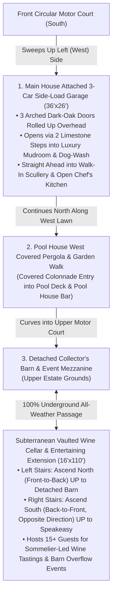

# Architect's Specification Sheet, Dual Closet Elevations & Outbuildings Plan

This specification document expands your approved main-residence concept to incorporate your exact layout preferences and architectural updates:
1. **Soaring 24-Foot Open First Floor (`DcL3q3doXhq` Video Architecture), Floor-to-Ceiling Matte-Black Steel & Glass Sliding Crittall Grid Partition, Barrel-Vaulted Pearlescent Moroccan Zellige-Tile Loggia & Back-of-Home Pool Doors Next to the China Cabinet** — while keeping **all Bedrooms, the Dedicated Home Theater, and the Dark Cherry / Mahogany Chef's Kitchen + 22-Foot Calacatta Verde/Viola Marble Island 100% unchanged**.
2. **Two Completely Separate His & Hers Closet + Shoe Suites** on Level 2 (each connected directly to its own opposite-side spa bathroom with `88" × 48"` Two-Person Soaking Tubs sized for 6'8" height).
3. **Hidden Speakeasy Secret Entrance Disguised as a Built-In Dark Cherry / Mahogany Illuminated China Cabinet Right Next to the Back-of-Home Pool Doors** on Level 1.
4. **Room-by-Room Architectural Finishes, Appliances, Floor Plan Schematics & Architecture Diagrams.**
5. **Interior Design for the 3-Bedroom Lenny Kravitz Maximalist Guest House (with 100% Glass-Surrounded Boss Woman Office), Two-Story Wellness / Health Facility, Detached Collector's Barn (`v8`), and Subterranean Vaulted Wine Cellar & 15-Guest Tasting Extension (`v4`).**

````carousel

<!-- slide -->
![2. Her's Upstairs Marble Bathroom (Second from West — With Private Enclosed WC Room Housing a Single Integrated White Porcelain Smart Bidet / Toilet Combo Behind a Solid Privacy Door + 88"×48" Two-Person Tub Sized for 6'8" Height): Groin-vaulted ceiling with triangular clerestory window, 10' fluted double vanity and a floor-to-ceiling private enclosed Calacatta Gold marble Water Closet room (with a solid fluted white-oak & opaque frosted reeded-glass privacy door swung ajar ~60° revealing the single integrated white porcelain Smart Bidet / Toilet Combo inside) on the left, monumental custom 88"×48"×26" (7.3-foot) Two-Person Carved Calacatta Gold Marble Soaking Tub sized for 6'8" height in the center, and 10'×8' frameless glass Walk-In Shower on the right, opening East into 3. Her's Closet, 4. His Closet & 5. Separate His Bathroom.](/home/brianvinson/.gemini/jetski/brain/96883fd9-49e4-474d-86a1-0423e4655f3f/hers_west_bath_with_toilet_and_bidet.jpg)
<!-- slide -->

<!-- slide -->

<!-- slide -->
![5. Separate His Dark Marble Bathroom (Far East End — With Private Enclosed WC Room Housing a Single Integrated Matte-Black Smart Bidet / Toilet Combo Behind a Solid Fluted Walnut Privacy Door, Arched Doorway Showing the Exact Matching Right Wing of the Dual-Sided Grand Staircase Descending DOWN to the Main Floor & 88"×48" Two-Person Tub Sized for 6'8" Height): Pitched dark smoked-oak timber rafters, monumental custom 88"×48"×26" (7.3-foot) Two-Person Honed Charcoal Pietra Grey Marble Soaking Tub sized for 6'8" height centered beneath the east gable window, 10'×8' black-steel & dark marble walk-in shower on the left, a floor-to-ceiling private enclosed dark Pietra Grey marble Water Closet room (with solid fluted dark-walnut arched privacy door swung ajar ~60° revealing the single integrated matte-black Smart Bidet / Toilet Combo inside), and on the far right the arched doorway opening onto the level white-oak upper balcony landing, signature oval-loop matte-black wrought-iron balustrade railing, LED-underlit light white-oak treads descending to the center mid-landing, recessed white-and-gold abstract painting niche, and tiered alabaster/brass chandelier matching the Dual-Sided Grand Staircase photo.](/home/brianvinson/.gemini/jetski/brain/96883fd9-49e4-474d-86a1-0423e4655f3f/his_east_bath_with_toilet_and_bidet.jpg)
<!-- slide -->
![Dual-Sided (Bifurcated Twin-Wing) Grand Staircase in the 24-Foot Great Hall (Against a Solid Windowless Interior Wall Where the Upstairs Closets Sit Directly Behind the Wall): Central white-oak staircase rising to a wide mid-landing against a solid windowless Venetian plaster artwork wall (zero exterior windows behind the stairs, respecting 3. Her's Closet & 4. His Closet directly behind that wall upstairs) before splitting into two symmetrical opposite upper flights—the Left (West) Wing ascending to tall double white-oak doors opening directly into 1. Upstairs Master Bedroom, and the Right (East) Wing ascending symmetrically to an arched dark smoked-walnut doorway opening directly into 5. Separate His Dark Marble Bathroom.](/home/brianvinson/.gemini/jetski/brain/96883fd9-49e4-474d-86a1-0423e4655f3f/dual_sided_grand_staircase.jpg)
<!-- slide -->
![Creative Concealed TV Viewing from the Great Hall Couch Area (Keeping the 24-Foot Open First Floor Great Hall 100% As-Is): Preserves the soaring 24-foot Great Hall, arched black-steel cathedral windows, single square pier, curved ivory bouclé couch, striped round coffee table, camel leather daybed, 12-seat oak dining table, and open black-steel Crittall glass partition to the Dark Cherry Kitchen 100% unchanged, while an ultra-thin zero-bezel 85-inch 4K OLED TV rises silently on a motorized brushed-brass column from inside a low-profile honed Roman travertine & fluted white-oak architectural plinth console and swivels directly toward the curved bouclé couch area.](/home/brianvinson/.gemini/jetski/brain/96883fd9-49e4-474d-86a1-0423e4655f3f/great_hall_tv_from_couch.jpg)
<!-- slide -->
![Open First Floor View 1 — Soaring 24-Foot Gallery-White Great Hall (DcL3q3doXhq Video Style: Towering Arched Black-Steel Cathedral Windows, Single Square Pier, Curved Bouclé Window Lounge, Camel Daybed & Travertine Center Lounge, and Open 12-Seat Natural Oak Formal Dining Hall) Looking Straight Through the Wide-Open Floor-to-Ceiling Matte-Black Steel & Glass Crittall Sliding Grid Partition Into the 100% Preserved Dark Cherry / Mahogany Chef's Kitchen & 22-Foot Calacatta Verde/Viola Marble Island.](/home/brianvinson/.gemini/jetski/brain/96883fd9-49e4-474d-86a1-0423e4655f3f/open_first_floor_v2_great_hall_to_dark_cherry_kitchen_1792816413555.jpg)
<!-- slide -->
![Open First Floor View 2 (Reverse Perspective) — Standing Inside the Preserved Dark Cherry / Mahogany Chef's Kitchen (Left, with 22-Foot Calacatta Verde/Viola Island, 6 Cream Stools & 60" Range) and Adjoining Barrel-Vaulted Pearlescent Moroccan Zellige-Tile Breakfast Loggia (Right, with Diagonal Checkerboard Limestone Floor, Potted Olive Tree & Black-Steel Doors Opening to the Back-of-Home Resort Swimming Pool & Wellness Center), Looking Through the Open Black-Steel Crittall Glass Grid Partition Into the Soaring 24-Foot Arched-Window Great Hall.](/home/brianvinson/.gemini/jetski/brain/96883fd9-49e4-474d-86a1-0423e4655f3f/open_first_floor_v3_kitchen_crittall_loggia_to_great_hall_1792819656798.jpg)
<!-- slide -->
![Open First Floor View 3 (Chef's Kitchen Close-Up) — Preserved 36'×26' Dark Cherry / Mahogany Chef's Kitchen Integrated Into the New Open First Floor: Foreground-Left 32°F–34°F Chilled Oyster Raw Bar & Damascus Knife Vault Column, 60" Black-and-Brass Range, Far-Left Built-In Dark Cherry / Mahogany Illuminated China Cabinet Secret Door Next to the Back-of-Home Pool Doors, Center 22-Foot Calacatta Verde/Viola Marble Slab Island with 6 Cream Stools, and Right-Hand Open Floor-to-Ceiling Black-Steel Crittall Glass Partition Opening to the Barrel-Vaulted Zellige Loggia, Back-of-Home Swimming Pool & 24-Foot Great Hall.](/home/brianvinson/.gemini/jetski/brain/96883fd9-49e4-474d-86a1-0423e4655f3f/open_first_floor_v3_kitchen_closeup_back_pool_view_1792819690582.jpg)
<!-- slide -->

<!-- slide -->

<!-- slide -->
![Inside the Narrow 12' × 18' Hidden Speakeasy (Aligned w/ Floorplan — True Photorealistic Brick Groin Vault, Continuous Pale European White-Oak Flooring & Foreground Cellar Staircase Wrapping Downward Toward the Pool Level Underground): Authentic reclaimed brick groin-vaulted ceiling and two illuminated antique-brick liquor arches on the left, continuous pale/blonde natural wide-plank European white-oak flooring matching the kitchen (View B) with an intimate ~4 to 4.5-foot walkway past the tufted cognac leather barstools, right-hand dark cherry doorway with the China Cabinet hinged on the stair-side jamb swinging outward into the kitchen (showing the kitchen's tall black-steel back door and nighttime swimming pool + Wellness Center), and a clearly visible foreground subterranean cellar staircase stepping down to a landing and wrapping downward and forward (North) towards the pool level underground (-12').](/home/brianvinson/.gemini/jetski/brain/96883fd9-49e4-474d-86a1-0423e4655f3f/speakeasy_v30_03_straight_wall_to_stairs_china_cabinet_swing.jpg)
<!-- slide -->
![Front-Left Wing "Mad Men" Executive Office & Library: 14-foot vaulted dark walnut beamed ceiling with brass Sputnik chandelier, carved French limestone fireplace with a flush-mounted 4K flat-screen TV recessed into the stone overmantel above, unobstructed oiled American black walnut bookcases (no ladder) & built-in crystal whiskey decanter bar, floating-top mid-century walnut & brass executive desk with Eames Time-Life chair, Eames Lounge Chair & Ottoman, and black steel windows framing the circular driveway and boxwood hedge maze.](/home/brianvinson/.gemini/jetski/brain/96883fd9-49e4-474d-86a1-0423e4655f3f/executive_office_mad_men_tv_no_ladder_jpg_1792692939300.jpg)
<!-- slide -->

<!-- slide -->

<!-- slide -->

<!-- slide -->

<!-- slide -->

<!-- slide -->

<!-- slide -->
![Detached 3-Bedroom Guest House Level 1 (Lenny Kravitz Paris Hôtel Particulier Maximalism — Cascading Murano Chandelier, Fluted Smoked-Walnut & Backlit Amber Kitchen, Zebra-Hide & Moroccan Rugs, Leopard Velvet Pillows, Vintage Les Paul Guitar, Single Straight-Run Staircase & Upper Mezzanine Glass-Surrounded Office): Monumental cascading 1970s Murano smoked-amber glass & brass chandelier, fluted smoked-walnut & backlit amber-glass Chef's Kitchen with 10-foot Nero Marquina marble waterfall island, cognac leather pit sectional layered with leopard velvet pillows & cream shearling throw over zebra-hide & Moroccan rugs, vintage Gibson Les Paul guitar on brass stand, carved West African sculptures, single straight-run floating walnut staircase, and upper-left 100% glass-surrounded "Boss Woman" Office.](/home/brianvinson/.gemini/jetski/brain/96883fd9-49e4-474d-86a1-0423e4655f3f/guest_house_v7_maximalist_level1_perfect_1792710442813.jpg)
<!-- slide -->
![Detached 3-Bedroom Guest House Level 2 View A (Lenny Kravitz Paris Hôtel Particulier Maximalism — Single Straight-Run Stairs, Brass-Framed B&W Rock Gallery Wall, Carved African Masks, Vinyl Record Console & 100% Glass-Surrounded "Boss Woman" Office on Right): Single straight-run floating walnut staircase arriving on a flat smoked-walnut herringbone mezzanine balcony beneath charcoal-espresso Venetian plaster walls curated with brass-framed B&W rock photography & carved African masks, cascading Murano smoked-amber glass chandelier, burl-wood vinyl record console, and the 100% glass-surrounded "Boss Woman" Executive Office on the right (burl-wood desk in the middle, cream bouclé chair behind desk facing away from wall).](/home/brianvinson/.gemini/jetski/brain/96883fd9-49e4-474d-86a1-0423e4655f3f/guest_house_v7_maximalist_level2_view_a_1792710125646.jpg)
<!-- slide -->
![Detached 3-Bedroom Guest House Level 2 View B (Lenny Kravitz Paris Hôtel Particulier Maximalism — 180° Reverse Angle Looking Back at the Single Straight-Run Stairs, 85-Inch TV & Vinyl Turntable Wall, and 100% Glass-Surrounded "Boss Woman" Office on Left): Shows the single straight-run floating walnut staircase descending straight down into the double-height living room below, the 85-inch flat-screen TV wall with burl-wood vinyl turntable credenza, brass-framed B&W rock portraits & vintage Gibson Les Paul guitar, and the exact same 100% glass-surrounded "Boss Woman" Executive Office on the left.](/home/brianvinson/.gemini/jetski/brain/96883fd9-49e4-474d-86a1-0423e4655f3f/guest_house_v7_maximalist_level2_view_b_1792710145597.jpg)
<!-- slide -->
![Inside Spotlight — Guest House 18'×15' Glass-Surrounded "Boss Woman" Executive Office with Single Oversized Natural Cowhide Rug (Desk to TV Area), Official Bird of Uganda (Grey Crowned Crane) Right Behind the Desk & Accessible 65-Inch 4K TV Facing the Desk: Standing inside the glass-enclosed Guest House office under warm focused ceiling spotlights, showing just one single oversized natural cowhide rug going under the sculptural burl-wood executive desk and stretching to the TV console area, a museum-lit portrait & sculpted bronze-and-gold statue of the Ugandan Grey Crowned Crane (Crested Crane, Balearica regulorum) right behind the desk inside the glowing LED arch Zoom backdrop, and a dedicated 65-inch 4K OLED flat-screen TV on a dark-walnut & brass media credenza along the left side of the office facing whoever is working at the desk, while looking out through the Crittall glass walls to the cascading Murano chandelier and Resort Swimming Pool.](/home/brianvinson/.gemini/jetski/brain/96883fd9-49e4-474d-86a1-0423e4655f3f/guest_house_boss_office_inside_tv.jpg)
<!-- slide -->

<!-- slide -->

<!-- slide -->
![Detached Collector's Barn — Daily Collector Mode v9 (4-Vehicle All-Black Fleet in an Angled Row Against the Left Wall, Zero Lift/Platform, 5 Matte-Black Circular LED Ring Chandeliers, Clean Rear Shiplap Wall with Only a Single Bathroom Door, Standard Solid-Riser White-Oak Staircase Over an Enclosed Vertical Shiplap Wall & Seamless Flush Vertical White Shiplap Hidden Under-Stair Door Shown CLOSED): All 4 all-black vehicles (Jet-Black Porsche Panamera, Black Tesla Model Y, Matte-Black Tesla Cybertruck, and Matte-Black GMC Hummer EV) backed in against the left wall and angled in a single continuous row on the flat unbroken dark charcoal stone floor, 5 sleek circular LED ring lights on the timber trusses, Upstairs Event Mezzanine (VIP Bouclé Lounge on Left, DJ/Sound Overlook in Center & Full Backlit Bar on Right), Windowed Side Space on the right, and a standard closed-riser white-oak staircase over a continuous, solid enclosed vertical white shiplap wall with the flush-inlaid vertical white shiplap hidden wine cellar door completely CLOSED and camouflaged into the wall.](/home/brianvinson/.gemini/jetski/brain/96883fd9-49e4-474d-86a1-0423e4655f3f/collectors_barn_v9_black_fleet.jpg)
<!-- slide -->
![Detached Collector's Barn — Event Conversion Option 1 v9 (Luxury Wedding Ceremony & Candlelit Banquet Reception, Identical 5 Circular LED Ring Lights, Single Rear Bathroom Door, Standard Solid-Riser White-Oak Staircase & Flush Vertical White Shiplap Hidden Door Covering the Wine Cellar Stairs): Exact same architectural view with all vehicles moved out—featuring white Belgian-linen banquet tables, gold velvet chairs, cascading white rose & hydrangea floral runners, identical 5 circular LED ring chandeliers, Upstairs Event Mezzanine (VIP Bridal Lounge on Left, Wedding DJ/Sound Booth in Center & Full Backlit Champagne Bar on Right), Windowed Side Space on the right, standard solid-riser white-oak staircase over an enclosed shiplap wall, and the flush vertical white shiplap hidden door swung partially open revealing the standard stairs descending straight DOWN into the wine cellar.](/home/brianvinson/.gemini/jetski/brain/96883fd9-49e4-474d-86a1-0423e4655f3f/collectors_barn_v9_wedding.jpg)
<!-- slide -->
![Detached Collector's Barn — Event Conversion Option 2 v9 (Evening Special Occasion, Black-Tie Gala & Craft Cocktail Lounge, Identical 5 Circular LED Ring Lights, Single Rear Bathroom Door, Standard Solid-Riser White-Oak Staircase & Flush Vertical White Shiplap Hidden Door Covering the Wine Cellar Stairs): Exact same architectural view in twilight gala configuration—featuring the identical 5 circular LED ring chandeliers, tufted emerald velvet & cognac leather Chesterfield lounge seating over Persian rugs, marble high-top cocktail tables, Upstairs Event Mezzanine (VIP Gala Lounge on Left, DJ/Sound Booth in Center & Full Backlit Mixology Bar on Right), Windowed Side Space cocktail bar, standard solid-riser white-oak staircase over an enclosed shiplap wall, and the flush vertical white shiplap hidden door swung partially open revealing the standard stairs descending straight DOWN into the wine cellar.](/home/brianvinson/.gemini/jetski/brain/96883fd9-49e4-474d-86a1-0423e4655f3f/collectors_barn_v9_gala.jpg)
<!-- slide -->

<!-- slide -->
![Attached 3-Car Side-Load Garage Interior (Doors Rolled Up, Without Cars Inside): Empty honed dark charcoal-slate 3-bay showroom floor, all three arched dark-oak carriage doors lifted overhead on high-lift black-steel ceiling tracks framing the sunlit cobblestone driveway and wisteria pergola outside, three Universal EV Fast Chargers & custom walnut tool cabinetry on the back wall, and two limestone steps on the right leading through wide-open dark-oak & glass French doors directly into the Luxury Mudroom, Dog-Wash Station, Butler's Scullery & Open Chef's Kitchen.](/home/brianvinson/.gemini/jetski/brain/96883fd9-49e4-474d-86a1-0423e4655f3f/attached_3car_garage_interior_doors_up_mudroom_entry.jpg)
<!-- slide -->
![Walking Into the Arched Side Door of the Attached 3-Car Side-Load Garage (First-Person POV): Standing at the open arched dark-oak & glass pedestrian side entry door looking inside—with custom dark cherry/walnut Mudroom locker cubbies and a tufted cognac-leather boot bench on the left, a Calacatta Gold marble Walk-In Dog-Wash Station with brass sprayer beside two honed limestone steps and wide-open French doors into the 3-Car Garage on the right, and a direct center archway leading straight into the Open Dark Cherry / Mahogany Chef's Kitchen and 22-foot Calacatta Verde/Viola marble island.](/home/brianvinson/.gemini/jetski/brain/96883fd9-49e4-474d-86a1-0423e4655f3f/attached_3car_garage_side_door_walk_in_view.jpg)
<!-- slide -->
![Subterranean Wine & Bourbon Tunnel (View 1 — One Continuous 120-Foot Long Tunnel with Side Room Removed, Bourbon Barrels on Left Wall & Wine Storage on Right Wall): 16'×120' single groin-vaulted antique brick & carved limestone tunnel (-12' below grade) with the Speakeasy staircase descending on the foreground-left, 3-tier heavy white-oak rickhouse racks of charred 53-gallon bourbon barrels along the entire Left Wall, continuous floor-to-ceiling bronze-framed glass & walnut wine storage cabinets (2,000+ bottles) along the entire Right Wall, live-edge dark walnut tasting table in the center aisle, and the glass-enclosed copper pot still & Barn staircase at the far end.](/home/brianvinson/.gemini/jetski/brain/96883fd9-49e4-474d-86a1-0423e4655f3f/subterranean_wine_tunnel_cellar.jpg)
<!-- slide -->

<!-- slide -->
![Subterranean Wine & Bourbon Tunnel (View 3 — Active 15-Guest Wine & Bourbon Tasting Reception Inside the Updated 120-Foot Long Tunnel): Approximately 15 well-dressed guests and a private sommelier/distiller enjoying an underground wine & bourbon tasting reception around the central live-edge walnut tasting table inside the exact same single long vaulted tunnel—with the Speakeasy stairs on the foreground-left, 3-tier bourbon barrel racks along the entire Left Wall, continuous backlit glass wine storage along the entire Right Wall, and the copper pot still & Barn stairs at the far end.](/home/brianvinson/.gemini/jetski/brain/96883fd9-49e4-474d-86a1-0423e4655f3f/subterranean_wine_cellar_v4_15_guests_wine_tasting.jpg)
````

---

## 1. Level 2 Primary Floor: Strict West-to-East 5-Room Linear Flow (`Bedroom ➔ Marble Bathroom ➔ Her's Closet ➔ His Closet ➔ Separate His Bathroom with Walk-In Shower`)

The entire second floor (`~3,800 Sq Ft`) is arranged in an unbroken **West-to-East** progression so each space flows logically into the next, while also connecting to the **Grand Staircase Gallery Bridge & Laundry Valet** along the south mezzanine corridor (overlooking the **Soaring 24-Foot Open First Floor Great Hall, Black-Steel Crittall Glass Partition & Preserved Dark Cherry Chef's Kitchen** below):

`[1. Master Bedroom (West End)] ➔ [2. Marble Bathroom ("Her's" Calacatta Gold Spa w/ 7.3' 2-Person Tub)] ➔ [3. Her's Closet (650-Pair Shoes & Couture)] ➔ [4. His Closet (470-Pair Sneakers & Suits)] ➔ [5. Separate His Bathroom with Walk-In Shower & 7.3' 2-Person Tub (Far East End)]`

```mermaid
flowchart LR
    subgraph Level2["LEVEL 2: WEST-TO-EAST PRIMARY FLOOR (~3,800 SQ FT)"]
        direction LR
        Bed["1. Master Bedroom (West End • 28'x22')\n• 16' Vaulted Gable & Fireplace\n• Left Staircase Wing Arrives Here"]
        Bath1["2. Her's Marble Bathroom (22'x16')\n• White/Gold Calacatta Marble\n• Private WC w/ Integrated Bidet/Toilet Combo\n• 88\"x48\" (7.3') 2-Person Tub & 10'x8' Shower"]
        Closet1["3. Her's Closet (~1,050 Sq Ft)\n• 650-Pair Illuminated Shoe Gallery\n• Directly Behind Solid Windowless Stair Wall"]
        Closet2["4. His Closet (~900 Sq Ft)\n• 470-Pair Sneaker, Boot & Dress Vault\n• Directly Behind Solid Windowless Stair Wall"]
        Bath2["5. Separate His Bathroom (East End • 22'x16')\n• Honed Dark Pietra Grey Marble\n• Private WC w/ Integrated Matte-Black Bidet/Toilet Combo\n• Right Staircase Wing Descends DOWN to 1st Floor"]

        Bed -->|"East Archway"| Bath1
        Bath1 -->|"East Archway"| Closet1
        Closet1 -->|"East Archway"| Closet2
        Closet2 -->|"East Archway"| Bath2
    end
```

### Vertical Millwork Elevation for the 1,000+ Pair Shoe Walls (10'0" / 120" Cabinet Height)

To store **1,120 pairs of shoes** across the two separate suites (`650 pairs` in West Suite 1 + `470 pairs` in East Suite 2) with museum-quality presentation:

| Vertical Zone (Height Above Finished Floor) | Tier / Function | Clear Height × Depth | Details & Hardware |
| :--- | :--- | :--- | :--- |
| **`106" – 120"` (Top 14")** | **Display Box & Seasonal Loft** | `14" H × 16" D` | Houses original collector boxes (Chanel, Hermès, Louis Vuitton, rare sneaker boxes) with integrated up-lighting. |
| **`92" – 106"` (Tiers 9 & 10)** | **Ladder-Access Evening / Collector Tiers** | `7" H × 14" D` (×2 tiers) | Accessed via **Putnam solid unlacquered brass rolling library ladders** on a continuous `92" AFF` perimeter rail. |
| **`28" – 92"` (Tiers 2 to 8)** | **Primary Eye-to-Waist Shoe Display (7 Tiers)** | `8.5" H × 14" D` (adjustable) | **West Suite:** 12° angled walnut shelves with recessed solid brass heel stops and anti-slip leather inlays.<br>**East Suite:** Flat smoked-oak shelves with tempered glass fronts and 3000K CRI-97 recessed LED channels. |
| **`4" – 28"` (Tier 1 / Boot Bay)** | **Tall Boot & High-Top Sneaker Base Tier** | `16"–22" H × 15" D` | Sized for knee-high riding/fashion boots (with internal cedar boot shapers) and high-top collector sneakers. |
| **`0" – 4"` (Toe Kick)** | **Illuminated Floating Plinth** | `4" H` recessed | Motion-activated warm LED toe-kick ribbon + concealed HVAC return slots for **48% RH leather preservation**. |

---

## 2. Level 1 Architecture Diagram: Soaring 24-Foot Open First Floor (`DcL3q3doXhq` Video Style), Retractable Black-Steel Crittall Glass Partition, Barrel-Vaulted Zellige Loggia, Unchanged Dark Cherry Kitchen & Back-of-Home Pool Doors Next to the China Cabinet

The updated Level 1 architecture integrates the soaring **24-Foot Open First Floor Great Hall, Floor-to-Ceiling Matte-Black Steel & Glass Sliding Crittall Grid Partition, and Barrel-Vaulted Pearlescent Moroccan Zellige-Tile Breakfast Loggia** from `https://www.instagram.com/p/DcL3q3doXhq/` while keeping **all Bedrooms, the Dedicated Home Theater, and the Dark Cherry / Mahogany Chef's Kitchen + 22-Foot Calacatta Verde/Viola Marble Island 100% unchanged**—and orients the **China Cabinet end of the Kitchen and Zellige Loggia directly at the Back of the Home overlooking the Resort Swimming Pool & Two-Story Wellness Center**:

```mermaid
flowchart TB
    subgraph FrontSouth["▼ FRONT OF HOME (SOUTH): CIRCULAR COBBLESTONE MOTOR COURT (~4.8' SHREK & FIONA STATUE) & BOXWOOD GARDENS ▼"]
        ArchedWin["Towering Two-Story Arched Matte-Black Steel Cathedral Windows"]
    end

    subgraph OpenFirstFloor["LEVEL 1 CENTRAL CORE: SOARING 24-FOOT OPEN FIRST FLOOR GREAT HALL (38'x28' • DcL3q3doXhq Architecture)"]
        ArchedWin --> Zone1["Zone 1: Arched-Window Lounge + Concealed Pop-Up/Swivel 85\" OLED TV\n• Curved Ivory Bouclé Sofa & Mid-Century Black Armchairs\n• Black-and-White Striped Round Coffee Table on Checkered Rug\n• Low-Profile Travertine & Fluted Oak Plinth w/ Motorized Pop-Up & 360°-Swivel 85\" OLED TV"]
        Zone1 --- Pier["Single Square Gallery-White Structural Pier\n(Anchors 3 Wall-Free Zones on Wide-Plank & Herringbone Oak Floors)"]
        Pier --- Zone2["Zone 2: Center Daybed & Travertine Lounge\n• Low-Profile Camel Leather Daybed\n• Nested Organic Travertine Stone Coffee Tables"]
        Pier --- Zone3["Zone 3: Open-Concept 12-Seat Formal Dining Hall + Windowless Dual-Sided Grand Staircase\n• 12-Seat Natural Oak Table & Sculpted Bouclé Chairs\n• Dual-Sided Grand Staircase Against Solid Windowless Interior Wall (Closets Above)"]
    end

    Zone3 -->|"West Oak Portal (100% Unchanged)"| WestWing["UNCHANGED WEST WING\n• Dedicated Burgundy-Velvet Theater (2 Rows w/ 5'-6' Aisle)\n• 'Mad Men' Office (Flush TV Above Fireplace & No Ladder)\n• Guest Suite #2 (Daybed & 85\" TV) • Mudroom & 3-Car Garage"]
    Zone3 -->|"East Oak Portal (100% Unchanged)"| EastWing["UNCHANGED EAST WING\n• Guest Suite #3 (Poolside En-Suite)\n• Guest Suite #4 (Garden Loggia Suite w/ Fireplace)"]

    OpenFirstFloor <-->|"FLOOR-TO-CEILING MATTE-BLACK STEEL & GLASS\nSLIDING CRITTALL GRID PARTITION WALL"| KitchenAndLoggia

    subgraph KitchenAndLoggia["PRESERVED DARK CHERRY / MAHOGANY CHEF'S KITCHEN (36'x26') & BARREL-VAULTED ZELLIGE LOGGIA (22'x14')"]
        Kitchen["100% Unchanged Dark Cherry / Mahogany Chef's Kitchen\n• 22' Calacatta Verde/Viola Marble Island (6 Cream Stools & LED Toe-Kick)\n• 32°F–34°F Oyster Raw Bar & Damascus Knife Vault Column\n• 60\" Black-and-Brass Range & Matte-Black/Brass Tapered Hood"]
        Loggia["Barrel-Vaulted Pearlescent Moroccan Zellige-Tile Loggia\n• Vaulted Cream/Pearl Zellige Tile Ceiling\n• Diagonal Gray-and-Cream Checkerboard Limestone Floor\n• Sculptural Potted Olive Tree & Bistro Table"]
        ChinaCab["Built-In Dark Cherry / Mahogany Illuminated China Cabinet Secret Door\n• Located at Back (North) End of Kitchen Wall Right Next to Back Pool Door\n• Swings Outward TOWARDS Kitchen Area on Concealed Pivot Hinges"]
        Kitchen --- Loggia
        Kitchen --> ChinaCab
    end

    ChinaCab <-->|"Swings Outward Toward Kitchen\n(100% Solid Pale White-Oak Floor)"| Speakeasy["Narrow Hidden Speakeasy Bar (12'x18' • 100% Solid Floor)\n• Brick Groin Vault, High Center-Brick TV & 2 Antique-Brick Liquor Arches\n• 100% Solid Pale White-Oak Floor & Matching Fluted Dark Wood Right Wall\n• Hidden Stairway Door in Back-Right Corner (Closed & Open w/ Stairs, -12')"]

    Kitchen -->|"Tall Black-Steel Back Pool Door\n(Right Next to China Cabinet)"| BackPool["▲ BACK OF HOME (NORTH): SPARKLING TURQUOISE RESORT SWIMMING POOL,\nLIMESTONE POOL TERRACE, TWO-STORY WELLNESS CENTER & 3-BED GUEST HOUSE ▲"]
    Loggia -->|"Tall Black-Steel French Doors"| BackPool
    Speakeasy -->|"Rear Black-Steel Pool Entrance"| BackPool
```

- **How the Secret Dark Cherry / Mahogany China Cabinet Door, Narrow `12' × 18'` Speakeasy & Back-Corner Matching Dark-Wood Hidden Stairway Door Work Together:**
  - **Positioned at the Back of the Home Right Next to the Pool Doors:** Built flush at the north (back) end of the kitchen cabinetry wall immediately beside the **Kitchen's tall black-steel mullioned back door overlooking the Resort Swimming Pool and Two-Story Wellness Center**, the floor-to-ceiling **rich dark cherry / mahogany China Cabinet** features mullioned glass doors, warm 2700K vertical LED shelf strips, and museum-grade clear acrylic/silicone gallery rail lips & micro-suction pads so every porcelain plate, bowl, tureen, and crystal stem stays 100% secure while the cabinet swings.
  - **Outward Swing Towards the Kitchen Area:** Engineered on a **Ritson/FritsJurgens heavy-duty concealed structural pivot system (rated to 1,100 lbs)** and concealed SOSS hinges on the jamb away from the pool, releasing the hidden magnetic latch allows the entire dark cherry / mahogany China Cabinet to swing smoothly **outward towards the kitchen island**.
  - **100% Solid Pale White-Oak Floor + Back-Corner Hidden Stairway Door in Matching Fluted Dark Cherry / Mahogany Wood (`View C1 Closed` & `View C2 Open`):** Inside the Speakeasy (`12' × 18'`), the entire floor (`0'` level) is **100% solid, flat, continuous pale blonde European white-oak hardwood planks** with zero floor cutouts and an unobstructed foreground entry. The right wall is clad in **vertical fluted deep dark cherry / espresso mahogany wood** matching the fluted bar front and kitchen doorway frame 100%, and located **towards the back-right corner** (just before the emerald-green velvet curtain and back pool doors) is the hidden door to the subterranean stairway—sitting **100% shut flush** when closed (`View C1`) and swinging open (`View C2`) to reveal a **single enclosed brick-vaulted subterranean staircase descending downward (`-12'`)** into the Wine Cellar & Bourbon Distillery Tunnel.
  - **Acoustic & Smoke Isolation:** The cabinet perimeter incorporates **Pemko acoustic compression seals** and an automatic mortised drop-bottom seal (`STC-55`), keeping the speakeasy completely soundproofed when closed.

---

## 3. Architect's Room-by-Room Finish, Fixture & Appliance Specification Sheet

### A. Large Open-Concept Chef's Kitchen (`36' × 26'`) Integrated Into the Soaring 24-Foot Open First Floor (`DcL3q3doXhq`) — Unified Dark Cherry / Mahogany Wood Cabinetry, 22-Foot Calacatta Verde/Viola Slab Island, Barrel-Vaulted Zellige Loggia & Back-of-Home Pool View
| Category | Recommended Specification | Architectural Notes |
| :--- | :--- | :--- |
| **Open First Floor Integration, Crittall Glass Partition, Barrel-Vaulted Zellige Loggia & Back-of-Home Pool Doors** | **`36' × 26'` Unchanged Dark Cherry / Mahogany Kitchen** + **Floor-to-Ceiling Matte-Black Steel & Glass Sliding Crittall Grid Partition** + **`22' × 14'` Barrel-Vaulted Pearlescent Moroccan Zellige-Tile Loggia** + **`38' × 28'` Soaring 24-Foot Arched-Window Great Hall** | Connects your 100% preserved Dark Cherry / Mahogany Kitchen and 22-foot island through a retractable floor-to-ceiling black-steel Crittall glass grid partition wall directly into the **Soaring 24-Foot Great Hall** (with towering arched black-steel cathedral windows at the Front/South and a single square pier dividing 3 open lounge/dining zones) and the **Barrel-Vaulted Pearlescent Zellige-Tile Loggia** (with diagonal checkerboard limestone floor tiles & potted olive tree)—while all exterior doors at the **China Cabinet end of the Kitchen and Zellige Loggia open onto the Back-of-Home Resort Swimming Pool & Two-Story Wellness Center**. |
| **`@builtbycarlene` 22-Foot Stone Slab Island & Lighting** | **Monumental `22' × 5'` Clutter-Free Polished Calacatta Verde / Calacatta Viola Marble Slab Island** + **Rich Dark Cherry / Mahogany Drawer Base w/ Horizontal Brushed-Brass Pulls & LED Toe-Kick** + **Tiered Ribbed-Glass & Brass Drum Chandeliers** | Inspired by Carlene Sarpong's (`@builtbycarlene`) kitchen design: creamy alabaster-white Italian marble slab with dramatic brecciated **sage-emerald green, deep burgundy-plum, and warm gold veining** and stepped edge profile, paired with **6 plush cream/champagne channel-split-back upholstered counter stools** and **3 cylindrical two-tier fluted/ribbed glass & brushed-brass drum chandeliers**. |
| **Unified Dark Cherry / Mahogany Custom Millwork** | **100% Matching Rich Dark Cherry / Mahogany Cabinetry Across Oyster Raw Bar Column, Stove Area, Island Base & Built-In China Cabinet Speakeasy Door** | All wooden cabinetry across the kitchen—including the 32°F–34°F Oyster Raw Bar & Damascus Knife Vault column, upper glass-front & lower drawer cabinets around the 60" stove, the 22-foot island base, and the built-in China Cabinet Speakeasy door next to the back pool doors—is crafted in the same rich dark cherry / mahogany stained wood. |
| **Professional Gas-Top Range & Pot Filler** | **60" Wolf Pro Dual-Fuel Range** (`DF60650CG`) *or* **La Cornue Château 150** + **Articulated Brass Pot Filler** | 6 to 8 high-BTU sealed/open gas burners + infrared charbroiler + French top plaque; wall-mounted unlacquered brass pot filler centered over the burners. |
| **2 Built-In Wall Ovens + Built-In Microwave** | **30" Wolf M-Series Convection Oven** + **30" Wolf Convection Steam Oven** (stacked right of range) + **24" Wolf Built-In Stainless Drawer/Drop-Down Speed Microwave** (in mahogany base cabinet left of range) | Gives you 4 full oven cavities plus a flush built-in stainless microwave at ergonomic counter height. |
| **6-Foot Trough Sink (In 22-Foot Island)** | **72" × 20" Custom Carved Dark Marble or Brushed Brass/Stainless Workstation Trough Sink** | Set into the 22-foot dark veined marble waterfall island; outfitted with **2 Waterworks Henry unlacquered brass bridge faucets**, 2 high-pressure glass rinsers, and sliding walnut/marble prep boards. |
| **Elite Upgrade 1: Integrated Culinary Modules** | **Gaggenau 400 Series Teppanyaki + Induction Wok Module + Sous-Vide Vacuum Sealer & Warming Drawers** | Flush-mounted beside the range or in the island prep zone, paired with a built-in vacuum-sealing drawer for sous-vide and two warming drawers to hold plates at 140°F. |
| **Elite Upgrade 2: Chilled Oyster Raw Bar Vitrine, Knife Vault & Espresso Program** | **32°F–34°F Chilled Oyster Raw Bar & Sashimi/Caviar Vitrine** + **Magnetic Damascus & Oyster-Shucking Knife Vault** + **Steamed Oshibori Towel Drawer** + **Plumbed Miele Espresso System** + **Zip Water HydroTap** | Replaces a redundant main-kitchen wine fridge (since 2,000+ bottles are in the underground Wine Tunnel) with a commercial-grade `32°F–34°F` forced-air & humidity-controlled (`85%–90% RH`) Chilled Oyster Raw Bar Vitrine featuring plumbed self-draining crushed-ice pans for fresh oysters on the half shell, lemon wedges, mignonette/cocktail cruets, and caviar, plus a magnetic Damascus knife vault, hot steamed towel drawer, direct-plumbed espresso bar, and boiling/chilled/sparkling water tap at the 6' trough sink. |
| **Elite Upgrade 3: Commercial Scullery & Dish Care** | **3 Dishwashers Total:** Dual Miele Knock-to-Open Dishwashers flanking the 6' Island Trough Sink + **Hobart/Miele Professional 90-Second High-Temp Sanitizing Dishwasher** in the Scullery | Ensures zero glassware or cookware buildup during large dinners, plus a walk-in **40°F Cold Room / Produce Pantry** and **Scotsman Nugget + Clear Craft Ice Makers**. |
| **Elite Upgrade 4: Wood-Fired Hearth / Rotisserie & Herb Wall** | **Built-In La Cornue Flamberge Gas Rotisserie** + **Recessed UV-Lit Living Culinary Herb Trough** | Flush-mounted wall rotisserie for restaurant-grade roast meats/poultry and a self-watering microgreen/herb channel integrated into the marble backsplash. |

### B. Level 2 Primary Bathrooms (Both Equipped with Custom `88" × 48" × 26"` Two-Person Soaking Tubs Sized for 6'8" Height)
| Category | Step 2: Her's Calacatta Gold Marble Bathroom (`24' × 18'`) | Step 5: Separate His Dark Pietra Grey Marble Bathroom (`24' × 18'`) |
| :--- | :--- | :--- |
| **Oversized `88" × 48" × 26"` (`7.3-Foot`) Two-Person Tub (Sized for 6'8" Height)** | **Custom Carved Calacatta Gold Marble / Cast-Stone Two-Person Soaking Tub (`88" L × 48" W × 26" Deep`):** Engineered for a 6'8" frame and two bathers reclining face-to-face or side-by-side, with dual ergonomic sloped backrests, two opposing waterproof headrests, inline constant-temperature water heater, and floor-mounted brushed-brass filler. | **Custom Honed Charcoal Pietra Grey Marble Two-Person Soaking & Hydrotherapy Tub (`88" L × 48" W × 26" Deep`):** Centered beneath the east gable window and proportioned for your 6'8" height and two bathers, with dual sloped backrests, two dark leather waterproof headrests, warm under-plinth LED glow, and dark platinum floor-mounted filler. |
| **10' × 8' Walk-In Shower Envelope** | Book-matched **Calacatta Gold marble slabs** with 3/8" Starphire low-iron frameless glass enclosure on the right wall. | Honed **Pietra Grey dark veined marble slabs** with blackened-steel & glass walk-in shower enclosure on the left wall. |
| **Shower Hydrotherapy & Steam** | **Dornbracht MEM Brushed Brass:** Dual 16" ceiling rain showers, 4 vertical body sprays, handheld wand, and **Mr.Steam Super3e** generator with AromaSteam & ChromaSteam. | **Dornbracht MEM Dark Platinum:** Dual 16" ceiling rain showers, 6 high-output hydrotherapy body jets, handheld wand, and zero-threshold **Schluter Kerdi-Line** drain. |
| **Vanity & Architectural Ceiling** | `10'0"` custom fluted oak double vanity on the left wall, groin-vaulted plaster ceiling with clerestory window, and **NuHeat hydronic floor heating**. | `12'0"` floating smoked-walnut & dark stone barber/grooming double vanity on the right wall under **pitched dark smoked-oak timber rafters** with radiant heated floors. |
| **Private Enclosed Water Closet (Single Integrated Smart Bidet / Toilet Combo)** | **Floor-to-Ceiling Enclosed Calacatta Gold Marble WC Room:** Solid fluted white-oak & opaque satin-frosted reeded-glass privacy door (with brass privacy lock & dedicated exhaust) housing a **single integrated white porcelain Smart Bidet / Toilet Combo (`TOTO Neorest NX2` / `Kohler Numi 2.0`)** with brushed-brass wall actuator plate & touchscreen remote (no separate second fixture). | **Floor-to-Ceiling Enclosed Dark Pietra Grey Marble WC Room:** Solid fluted dark smoked-walnut arched privacy door (with dark-bronze privacy lock & dedicated exhaust) housing a **single integrated matte-black Smart Bidet / Toilet Combo (`TOTO Neorest` / `Kohler Numi 2.0` Matte Black)** with dark-bronze wall actuator plate & remote (no separate second fixture). |
| **Dual-Sided Grand Staircase Connection** | Accessed via **1. Master Bedroom** (where the **Left / West Upper Wing** of the Dual-Sided Grand Staircase arrives through double white-oak doors). | Features a **direct arched dark smoked-walnut doorway** on the right wall opening onto the upper landing where the **Right / East Upper Wing** of the Dual-Sided Grand Staircase **descends DOWNWARD to the 1st-floor Great Hall**. |

### C. "Mad Men" Executive Office & Vintage Velvet Couch Theater Room (West Wing)
| Space | Architectural Finishes & Millwork | Audio / Visual & Lighting Systems |
| :--- | :--- | :--- |
| **"Mad Men" Executive Office (`18' × 16'`)** | • Hand-carved French limestone mantel on the left wall + **flush-mounted 4K flat-screen TV recessed into the stone overmantel above**.<br>• Dark walnut herringbone parquet floors & floor-to-ceiling oiled American black walnut bookcases (**no rolling ladder**—sized for your 6'8" reach) + crystal whiskey decanter bar.<br>• Floating walnut & brass desk with Eames Time-Life chair & Eames Lounge Chair. | • **Lutron HomeWorks QS** motorized solar & drapery shades on the steel casement windows.<br>• Concealed ceiling array microphone & 4K camera hidden in bookcase molding for executive video calls. |
| **Dedicated Snuggle Theater (`22' × 18'`)** | • **Two Tiered Stadium Rows of Deep Burgundy Velvet Snuggle Couches (`48"` seat depth) BOTH Facing Straight Toward the Screen:** Front-row channel-tufted deep burgundy/merlot velvet snuggle couch with twin chaise extensions positioned **closer to the 150-inch movie screen** on the lower level, and second-row button-tufted deep burgundy/merlot velvet snuggle couch with twin chaises elevated on the stadium riser behind it—both parallel to and facing dead-on straight at the screen.<br>• Dark navy acoustic velvet wall panels with bronze LED sconces + fiber-optic starlight coffered ceiling. | • **150" Stewart Filmscreen** acoustically transparent 2.35:1 CinemaScope screen.<br>• **Sony Bravia Projector 9 (VPL-XW8100ES)** 4K laser projection in a hushed rear projection closet.<br>• **Dolby Atmos 9.4.6** concealed speaker system (Triad Gold/Meyer Sound) with 4 manifold subwoofers built into the riser. |

---

## 4. Interior Design for the 3-Bedroom Detached Guest House (Lenny Kravitz × CB2 Style with 100% Fully Glass-Enclosed Boss Woman Office), Two-Story Wellness / Health Facility & Detached Barn

Your reference photograph includes three remarkable secondary structures behind the main house that turn the property into a private resort compound:

```mermaid
flowchart TD
    Main["Main Residence Back-of-Home Pool Doors\n(From Kitchen/China Cabinet, Barrel-Vaulted Zellige Loggia, Speakeasy & Suite #3)"] --> Pool["Central Courtyard Resort Swimming Pool, Baja Sun Shelf & Sunken Fire Pit"]
    Pool --> GuestHouse["1. Two-Story 3-Bedroom, 2-Bathroom Guest House (~2,800 Sq Ft • Lenny Kravitz Maximalism)\n• Level 1: Smoked-Walnut & Nero Marquina Kitchen, Cognac Leather/Zebra Lounge, Bed #1, Bath #1 & Straight-Up Stairs\n• Level 2: 100% Glass-Surrounded 'Boss Woman' Office, 85\" TV Wall, Bedrooms #2 & #3 + Full Bath #2"]
    Pool --> Wellness["2. Two-Story Wellness / Health Facility (~1,600 Sq Ft • East Breezeway Wing)\n• Level 1: Bubbling Hot Tub, Cedar Sauna & Walk-Through Open Shower Area (Opens Directly to Pool)\n• Level 2: Workout Facility w/ Large 85\" TV + Complete Upstairs Full Bathroom"]
    GuestHouse <-->|"Covered Breezeway"| Wellness
    GuestHouse -.->|"West Cobblestone Drive"| Barn["3. Detached Collector's Barn v9 (~3,250 Sq Ft)\n• Level 1: 4 All-Black Cars in Angled Row (Zero Lift), Flat Unbroken Stone Slab, 5 Circular Ring Lights, Single Rear Bath Door & Windowed Side Space\n• Standard Solid-Riser White-Oak Staircase Over Enclosed Vertical White Shiplap Under-Stair Wall\n• Hidden Wine Cellar Entry: Seamless Flush Vertical White Shiplap Secret Pivot Door (R-24/STC-45) Covering Standard Stairs Down (-12') to Wine Cellar\n• Level 2 Event Mezzanine: Full Backlit Bar (Right), DJ/Lighting Overlook (Center) & VIP Lounge (Left)"]
    Barn <-->|"Hidden Shiplap Under-Stair Door (-12' Elev)"| WineCellar["4. Subterranean Vaulted Wine Cellar & 15-Guest Tasting Extension (16'x110')\n• Left Stairs Ascend North (Front-to-Back) UP to Barn Under-Stair Hidden Shiplap Door\n• Right Stairs Ascend South (Back-to-Front, 180° Opposite) UP to Main House Speakeasy"]
    WineCellar <-->|"Right Wall Stairs"| Main
```

### 1. Two-Story 3-Bedroom, 2-Bathroom Detached Guest House (`~2,800 Sq Ft`, Lenny Kravitz Paris *Hôtel Particulier* & Kravitz Design × CB2 Rock-and-Roll Maximalism — Straight-Up Stairs & 100% Glass-Surrounded "Boss Woman" Office)

![Detached Guest House Level 1 (Lenny Kravitz Paris Hôtel Particulier Maximalism) — Monumental Cascading 1970s Murano Smoked-Amber Glass & Brass Chandelier, Fluted Smoked-Walnut & Backlit Amber-Glass Chef's Kitchen with 10-Foot Nero Marquina Marble Waterfall Island, Cognac Leather Sectional Layered with Leopard Velvet Pillows & Cream Shearling Throw over a Zebra-Hide & Moroccan Rug, Burl-Wood Plinth Coffee Table, Vintage Gibson Les Paul Guitar on Brass Stand, Carved African Totemic Sculptures, Single Straight-Run Floating Walnut Staircase, and Upper-Left 100% Glass-Surrounded "Boss Woman" Office](/home/brianvinson/.gemini/jetski/brain/96883fd9-49e4-474d-86a1-0423e4655f3f/guest_house_v7_maximalist_level1_perfect_1792710442813.jpg)

![Detached Guest House Level 2 View A (Lenny Kravitz Paris Hôtel Particulier Maximalism) — Single Straight-Run Floating Walnut Staircase Arriving on the Smoked-Walnut Herringbone Mezzanine Balcony Beneath Charcoal-Espresso Venetian Plaster Gallery Walls Curated with Brass-Framed B&W Rock Photography & Carved African Masks, Cascading Murano Smoked-Amber Glass Chandelier in the Double-Height Void, Burl-Wood Vinyl Record Console, and the 100% Glass-Surrounded "Boss Woman" Office on the Right (Burl-Wood Desk in Middle, Cream Bouclé Chair Behind Desk Facing Away from Wall, Layered Persian Rug & Leopard-Pillow Cognac Lounge Chair)](/home/brianvinson/.gemini/jetski/brain/96883fd9-49e4-474d-86a1-0423e4655f3f/guest_house_v7_maximalist_level2_view_a_1792710125646.jpg)


- **Lenny Kravitz Paris *Hôtel Particulier* & Kravitz Design × CB2 Rock-and-Roll Maximalism:** Dialed up to full soulful rock-star maximalism inspired by Lenny Kravitz's Paris residence in *Architectural Digest*—featuring:
  - **Monumental 1970s Murano Chandelier & Backlit Amber Cabinetry:** A dramatic **multi-tiered cascading 1970s Italian Murano smoked-amber glass & brushed-brass chandelier** suspended through the double-height living room void (complementing the smoked-glass Sputnik chandelier over the 10-foot Nero Marquina marble waterfall island and **warm amber-lit glass upper display cabinets** in the fluted smoked-walnut kitchen).
  - **Charcoal-Espresso Venetian Plaster Gallery Walls & Tribal Art:** Hand-troweled **moody charcoal-espresso Venetian plaster walls** curated with **oversized brass-framed black-and-white rock-and-roll photography** (Jimi Hendrix, Miles Davis, Prince) alongside **museum-mounted hand-carved West African tribal masks and tall totemic wood sculptures**.
  - **Layered Exotic Textiles & Animal Prints:** A **graphic zebra-hide rug layered diagonally over the oversized vintage black-and-cream Moroccan wool rug**, plus **leopard-print velvet pillows, deep oxblood velvet cushions, and a plush cream Mongolian shearling throw** draped across the channel-tufted cognac leather pit sectional.
  - **Rock-Star Instruments, Vinyl & Brutalist Brass Accents:** A **vintage sunburst Gibson Les Paul electric guitar on a brass stand** beside the dark stone fireplace, a **Paul Evans–inspired brutalist brass floor lamp**, a **heavy burl-wood plinth coffee table** stacked with oversized Taschen music/art monographs and brass candleholders, and a **burl-wood & brass audiophile vinyl record credenza with turntable** on Level 2.
- **Consistent Single Straight-Run Staircase (Goes Straight Up, Zero Wrap-Around Across All 3 Pictures):** Across Level 1, Level 2 View A, and Level 2 View B, the floating dark-walnut staircase with frameless glass balustrade rises **100% straight up in a single unbroken straight flight (no wrap-around, no turns)** along the side of the double-height living room to the flat, single-level smoked-walnut herringbone mezzanine balcony.
- **Large 100% Glass-Surrounded "Boss Woman" Video-Conference Executive Office Overlooking the Main Part of the House (`18' × 15'`, Consistent Across All Pictures + Dedicated Inside Spotlight):** Completely enclosed on **all interior sides** in sound-insulated **floor-to-ceiling matte-black architectural steel-and-glass grid partitions (`STC-48`)** with double French glass doors, positioned on the Level 2 mezzanine so it **directly overlooks the main double-height living room and kitchen of the Guest House below AND looks out through the soaring two-story black-steel gable window across the swimming pool toward the Main Residence**. Inside, the **sculptural burl-wood & brass executive desk sits in the middle of the office** over **just one single oversized natural hair-on cowhide rug** that goes underneath the desk and stretches all the way to the **65-inch 4K OLED TV console area** on the left. With the brown armchair beside the TV console removed, a **symmetrical pair of two identical rounded cream bouclé barrel guest chairs** sits side-by-side in front of the desk facing the **cream bouclé & brass executive swivel chair** behind the desk. Directly behind the desk inside the illuminated **fluted smoked-walnut arched "Zoom Power Backdrop" wall** sits a museum-lit **portrait and sculpted bronze-and-gold statue of the official bird of Uganda—the Grey Crowned Crane (Crested Crane, *Balearica regulorum*)**, with **2 sculptural polished natural Ugandan Ankole longhorn cow horns on brushed-brass stands** resting on the credenza right behind the desk and directly in front of the crane portrait on the wall.
- **Complete 3-Bedroom, 1.5-Bathroom Guest House Program + Full Kitchen, 85-Inch TV & Narrow Edwardian Emerald-Green Glazed Tile & Brass Downstairs Half Bathroom (`https://www.instagram.com/p/DdHE1m_Adpt/`):** Level 1 houses the **fluted smoked-walnut & Nero Marquina marble Chef's Kitchen**, **maximalist cognac leather & zebra/Moroccan Fireside Living Room**, **Downstairs Guest Bedroom #1**, and the **Narrow Downstairs Half Bathroom (`~4.5' × 8'` Powder Room — Edwardian Emerald-Green Glazed Ceramic Tile & Unlacquered Brass Cloakroom inspired by `https://www.instagram.com/p/DdHE1m_Adpt/`)**; Level 2 houses **Upstairs Guest Bedrooms #2 & #3**, **Upstairs Full Bathroom #2**, and the **85-inch 4K TV wall with burl-wood vinyl turntable console**.

#### Downstairs Narrow Half Bathroom in the Guest House (`~4.5' × 8'` Powder Room — Intimate Edwardian Emerald-Green Glazed Ceramic Tile & Unlacquered Brass Cloakroom Inspired by `https://www.instagram.com/p/DdHE1m_Adpt/`)
![Guest House Downstairs Narrow Half Bathroom (~4.5' x 8' Powder Room — Inspired by https://www.instagram.com/p/DdHE1m_Adpt/) — Kept Narrow and Uncluttered Like the Instagram Video: Sleek Courses of High-Gloss Deep Emerald / Victorian Bottle-Green Beveled Subway Tiles with a Single Molded Ceramic Dado Rail Along the Left & Right Walls, Compact White Porcelain Edwardian Pedestal Washbasin with Unlacquered Brass Crosshead Taps, Arched Antique-Brass Mirror with Crest Medallion & Twin Opal-Glass Globe Wall Sconces Centered on the Narrow Back Wall Beneath the Semicircular Radial Emerald Sunburst Fan-Arch (Lunette), Heritage High-Level White Porcelain Cistern Toilet with Long Brass Flush Pipe & Dark Walnut Seat Tucked Neatly Along the Right Wall, Narrow Barrel-Coved Emerald Ceiling with Twin Brass Pipes & Central Brass Pendant Lantern, and Emerald-and-Gold Mosaic Floor Runner with Central Floral Medallion](/home/brianvinson/.gemini/jetski/brain/96883fd9-49e4-474d-86a1-0423e4655f3f/guest_house_downstairs_bathroom.jpg)

- **Guest House Downstairs Narrow Half Bathroom (`~4.5' × 8'` Powder Room — Styled Directly After `https://www.instagram.com/p/DdHE1m_Adpt/`):**
  - **Narrow, Uncluttered Cloakroom Proportions (`~4.5' Wide` Like the Video):** Adjusted to a single narrow, intimate cloakroom width (`~4.5 feet wide`) and simplified wall treatment (removing busy multi-frame side panels and double-wide alcoves) so the space feels calm, focused, and authentic to the video rather than busy or overwhelming.
  - **Calm Emerald-Green Beveled Subway Tile Side Walls & Radial Sunburst Back-Wall Lunette:** The left and right walls feature clean, continuous courses of high-gloss Victorian bottle-green beveled subway tiles (`metro tiles`) with a single horizontal molded ceramic dado rail, leading the eye straight to the semicircular **radial emerald-green sunburst fan-arch (`lunette`)** crowning the narrow back wall.
  - **Half-Bathroom Fixture Layout (Compact Pedestal Basin + Tucked Heritage Toilet):** Centered on the narrow back wall is a compact white porcelain Edwardian pedestal washbasin with unlacquered brass crosshead taps beneath an arched antique-brass crest mirror and twin glowing opal-glass globe wall sconces, while the heritage high-level white porcelain cistern toilet with long polished-brass flush pipe, pull chain, and dark-walnut seat is neatly tucked along the right wall.
  - **Narrow Coved Ceiling & Mosaic Medallion Floor Runner:** Crowned by a narrow emerald-tiled barrel-coved ceiling with twin brass pipes and a single cylindrical brass-and-ribbed-glass pendant lantern over a dark glazed brick border and narrow emerald-and-gold mosaic floor runner with a central floral medallion.

### 2. East Breezeway Building: Two-Story Wellness / Health Facility (`~1,600 Sq Ft`, Connected to the Right of the Pool)


- Linked to the Guest House via the covered breezeway visible in your photo, this two-story gabled **Wellness / Health Facility** is dedicated to hydrotherapy downstairs and athletic performance upstairs:
  - **Level 1 — Hydrotherapy Hot Tub, Finnish Cedar Sauna & Walk-Through Open Shower Area Opening Directly to the Pool (`~850 Sq Ft`):** Features three tall black-steel doors folded wide open directly to the outdoor pool area, a sunken **bubbling heated stone Hot Tub** (plus 39°F cold plunge) in the center, a glass-front **Finnish cedar dry sauna** on the left, a **walk-through Open Shower Area** (open fluted travertine wet-deck with overhead brass rain shower, body jets, and backlit towel niche—no glass door) right beside the sauna, and the **floating white-oak & blackened-steel staircase ascending directly to the Workout Facility above**.
  - **Level 2 — Workout Facility with Large 85-Inch Flat-Screen TV & Complete Upstairs Full Bathroom (`~750 Sq Ft`):** Directly above the Sauna and Hot Tub under vaulted whitewashed oak scissor trusses, featuring a **flush-mounted 85-inch 4K flat-screen TV on the right plaster wall** above the stairs, **two indoor spinning bikes**, pool-facing commercial slat-belt treadmills, walnut Reformer Pilates carriage, a **matte-black Bench Press station and adjustable dumbbell rack in the back-left corner**, a recessed travertine **Hydration & Towel Bar**, AND a **complete Upstairs Full Bathroom** in the rear-right corner (with floating Calacatta marble vanity, backlit mirror, private toilet alcove, and glass-enclosed walk-in rain shower).

### 3. Detached Collector's Barn & Multi-Purpose Special Events / Wedding Pavilion (`~3,250 Sq Ft` Total Including the Windowed Side Space & Level 2 Event Bar / VIP Lounge Mezzanine)

#### Mode A — Daily Collector Gallery with All 4 All-Black Cars Backed In & Angled in a Single Row (No Lift/Platform), 5 Circular LED Ring Lights, Single Rear Bathroom Door, Standard Solid-Riser Staircase & Flush Vertical White Shiplap Hidden Door Shown CLOSED
![Detached Collector's Barn (Daily Collector Mode v9 — Hidden Door CLOSED) — All 4 All-Black Vehicles (Jet-Black Porsche Panamera, Black Tesla Model Y, Matte-Black Tesla Cybertruck & Matte-Black GMC Hummer EV) Backed In Against the Left Wall and Angled in a Single Continuous Row on the Flat Unbroken Stone Floor (Zero Lift or Platform, Zero Floor Cutout), 5 Sleek Matte-Black Circular LED Ring Chandeliers on the Vaulted Timber Ceiling, Clean Rear Shiplap Wall with Only a Single Bathroom Entrance Door, Upstairs Event Mezzanine (VIP Bouclé Lounge on Left, DJ/Sound Overlook in Center & Full Backlit Bar on Right), Windowed Side Space on the Right, Standard Solid-Riser White-Oak Staircase Over an Enclosed Vertical White Shiplap Wall, and the Seamless Flush Vertical White Shiplap Hidden Under-Stair Door Shown Completely CLOSED and Camouflaged Into the Under-Stair Wall](/home/brianvinson/.gemini/jetski/brain/96883fd9-49e4-474d-86a1-0423e4655f3f/collectors_barn_v9_black_fleet.jpg)

#### Mode B (Event Option 1) — Enchanted Luxury Wedding Ceremony & Candlelit Banquet Reception (Exact Same View, Identical 5 Circular LED Ring Lights, Single Rear Bathroom Door, Standard Solid-Riser Staircase & Flush Vertical White Shiplap Hidden Door Shown OPEN Revealing the Wine Cellar Stairs)
![Detached Collector's Barn (Event Conversion Option 1 v9 — Luxury Wedding Ceremony & Banquet Reception) — Exact Same View & Identical 5 Matte-Black Circular LED Ring Lights as the Garage Picture, Clean Rear Shiplap Wall with Only a Single Bathroom Entrance Door, White Belgian-Linen Banquet Tables with Gold Velvet Chairs & Cascading Floral Runners, Upstairs Event Mezzanine (VIP Bridal Lounge on Left, Wedding DJ/Sound Booth in Center & Full Backlit Champagne Bar on Right), Sunlit Windowed Side Space on the Right, Standard Solid-Riser White-Oak Staircase Over an Enclosed Vertical White Shiplap Wall, and a Seamless Flush Vertical White Shiplap Hidden Door Swung Partially Open Revealing the Standard Stairs Descending Straight DOWN into the Subterranean Wine Cellar](/home/brianvinson/.gemini/jetski/brain/96883fd9-49e4-474d-86a1-0423e4655f3f/collectors_barn_v9_wedding.jpg)

#### Mode C (Event Option 2) — Evening Special Occasion, Black-Tie Gala & Craft Cocktail Lounge (Exact Same View, Identical 5 Circular LED Ring Lights, Single Rear Bathroom Door, Standard Solid-Riser Staircase & Flush Vertical White Shiplap Hidden Door Covering the Wine Cellar Stairs)
![Detached Collector's Barn (Event Conversion Option 2 v9 — Evening Special Occasion, Black-Tie Gala & Cocktail Lounge) — Exact Same View & Identical 5 Matte-Black Circular LED Ring Lights as the Garage Picture, Clean Rear Shiplap Wall with Only a Single Bathroom Entrance Door, Tufted Emerald-Green Velvet & Cognac Leather Chesterfield Lounge Groupings over Vintage Persian Rugs, Nero Marquina Marble High-Tops, Upstairs Event Mezzanine (VIP Gala Lounge on Left, DJ/Sound Booth in Center & Full Backlit Mixology Bar on Right), Windowed Side Space on the Right, Standard Solid-Riser White-Oak Staircase Over an Enclosed Vertical White Shiplap Wall, and a Seamless Flush Vertical White Shiplap Hidden Door Swung Partially Open Revealing the Standard Stairs Descending Straight DOWN into the Subterranean Wine Cellar](/home/brianvinson/.gemini/jetski/brain/96883fd9-49e4-474d-86a1-0423e4655f3f/collectors_barn_v9_gala.jpg)

- **Identical Architectural Ceiling Lighting Across All 3 Visuals:**
  - All three Barn modes (Mode A 4-Car Fleet, Mode B Wedding Reception, and Mode C Evening Gala) feature the **exact same 5 sleek matte-black circular LED ring chandeliers** suspended from the vaulted Douglas-fir timber trusses beneath the central ridge skylight.
- **Clean Rear Wall with Only a Single Bathroom Entrance Door:**
  - The back wall under the mezzanine is a clean, continuous white vertical shiplap wall with warm LED cove lighting and **no doors in the back except for a single sleek dark-oak / matte-black framed Bathroom Entrance Door** in the center.
- **Standard Solid-Riser White-Oak Staircase (Not Floating) & Seamless Flush-Jamb Vertical White Shiplap Hidden Door Covering the Stairs Down to the Wine Cellar:**
  - **Standard Closed-Riser Staircase & Unbroken Stone Floor Slab:** Rather than floating open-riser treads or an open glass stairwell hole in the floor, the right-wall staircase ascending to the Level 2 Event Mezzanine is a **standard solid-riser natural white-oak staircase** (solid white-oak treads and solid closed risers) built over a **solid enclosed vertical white shiplap triangular wall**—keeping 100% of the dark charcoal basalt floor slab unbroken, flat, and load-rated for heavy EVs (`~9,000-lb` Hummer EV, `~6,800-lb` Cybertruck), detailing washdowns, catering carts, and 180 wedding guests in formalwear.
  - **Best Hidden Door for the Barn's Multi-Purpose Usage — Seamless Flush-Jamb Vertical White Shiplap Architectural Pivot Door (`R-24` Thermal / `STC-45` Acoustic Seal):**
    - Built flush into the tall section of the enclosed vertical white shiplap under-stair wall, the hidden door uses **precision-milled vertical tongue-and-groove white shiplap planks** whose vertical seams align with the surrounding shiplap wall panels, finished with a continuous natural white-oak baseboard, heavy-duty concealed FritsJurgens pivot hinges, and a **hidden magnetic push-latch + RFID/biometric actuator** (zero visible hinges, frame, or handle).
    - **Why This Hidden Door Type Wins Across All 3 Shed Usages:**
      1. *Mode A (4-Car Collector Garage):* Impervious to detailing spray and dust; avoids floor hatch weak points or glass display shelves that collect garage dust.
      2. *Mode B (180-Guest Wedding Reception):* When closed, it looks like a 100% solid structural shiplap wall—preventing curious wedding guests or catering staff from discovering or entering the private `2,000+ bottle` wine cellar and Main House Speakeasy, and never competing visually with the upstairs backlit Mezzanine Bar right above the stairs.
      3. *Mode C (Evening Black-Tie Gala & VIP Wine Tasting):* Swings open (`~45°`) at the touch of the concealed latch to reveal the **warm amber-LED-lit standard staircase descending straight DOWN (`-12'` below floor level)** into the Subterranean Wine Cellar & 15-Guest Tasting Extension.
- **All 4 All-Black Vehicles Backed In Against the Left Wall and Angled in a Single Continuous Row (Zero Lift / Platform):**
  - With **no car lift or platform**, all 4 vehicles in your all-black fleet sit directly on the polished dark charcoal stone slab floor **backed in against the left wall at a uniform ~45-degree showroom angle in a single continuous row**:
    1. **Front-Left Foreground:** **Jet-Black Porsche Panamera** (glossy black paint, black rims, dark tint).
    2. **Second in the Row:** **Black Tesla Model Y** (glossy black paint, black turbine wheels, dark tint).
    3. **Third in the Row:** **Matte-Black Wrapped Tesla Cybertruck** (stealth matte-black wrap, black wheels).
    4. **Fourth in the Row:** **Matte-Black GMC Hummer EV SUV** (matte-black finish, black off-road wheels).
- **Redesigned Level 2 Event-Hosting Mezzanine Loft (`~1,200 Sq Ft` — Full-Service Bar, VIP Lounge & DJ / Sound & Lighting Overlook):**
  - Purpose-built for weddings, black-tie galas, and private events (with the pool table completely removed):
    1. **Right Bay — Full-Service Architectural Event & Mixology Bar:** Warm amber-backlit multi-tier glass liquor & champagne display wall, fluted dark-walnut and brushed-brass bar counter with honed Calacatta marble top, under-counter chillers, and cognac-leather barstools.
    2. **Center Overlook — Integrated DJ, Acoustic Sound & Lighting Control Station:** Centered behind the frameless glass balustrade overlooking the entire main timber hall below.
    3. **Left Bay — VIP Bridal & Cocktail Lounge:** Curved cream bouclé and cognac-leather sectional sofa, velvet club chairs, and round brass-and-marble champagne tables.
- **Representing the Property Aerial View — Lower Shed-Roofed Side Space with Windows (`~450 Sq Ft`, `12' × 38'` Right Wing):**
  - Matching the exterior property aerial view of the Barn, the interior opens between heavy white-oak colonnade posts into a bright **Windowed Side Space** overlooking the green estate lawn and mature trees.
- **Architectural & Mechanical Event Conversion Specifications (`120–180 Seated Banquet Guests` / `250+ Cocktail Guests`):**
  - Equipped with a dedicated **400A 3-phase event power subpanel**, **concealed 1,000-lb rigging points** along the oak scissor trusses, and **high-capacity commercial VRF climate control** sized for 200+ guests.

---

## 5. Attached 3-Car Side-Load Garage (Exterior & Interior with Doors Up) & How It Opens Into the Main Home

Looking at the left (west) side of your aerial photograph, a continuous paved stone driveway sweeps from the front circular motor court all the way past the left wing of the main house, past the left pergola of the pool house, and directly into the motor court of the Detached Barn at the top of the property.



### A. Inside the Attached 3-Car Daily-Driver Garage (Doors Rolled Up, Zero Cars Inside) & What It Looks Like Walking Into the Arched Side Door

#### View 1 — Inside the 3-Bay Showroom Garage Looking Toward the Open French Doors Into the Mudroom & Kitchen
![Attached 3-Car Side-Load Garage Interior (Doors Rolled Up, Without Cars Inside) — Empty Honed Dark Charcoal-Slate 3-Bay Showroom Floor, Three Arched Dark-Oak Carriage Doors Lifted Overhead on High-Lift Black-Steel Tracks Framing the Sunlit Cobblestone Driveway & Wisteria Pergola Outside, Three EV Fast Chargers & Custom Walnut Tool Cabinetry on the Back Wall, and Two Limestone Steps on the Right Leading Through Wide-Open Dark-Oak & Glass French Doors Directly Into the Luxury Mudroom, Dog-Wash Station, Butler's Scullery & Open Chef's Kitchen](/home/brianvinson/.gemini/jetski/brain/96883fd9-49e4-474d-86a1-0423e4655f3f/attached_3car_garage_interior_doors_up_mudroom_entry.jpg)

#### View 2 — First-Person View Walking North Into the 90°-Angled Arched Side Door (Past the 3rd Garage Bay in A. Exterior View) Into the First-Floor Laundry & Pool-Towel Valet Room (`16' × 14'`)
![Walking Into the 90°-Angled Arched Side Door Past the Attached 3-Car Garage Into the First-Floor Laundry & Pool-Towel Valet Room — Open Arched Dark-Oak & Glass Pedestrian Side Door in the Left Foreground Revealing the White Painted-Brick 3-Car Garage Carriage Doors & Copper Lantern Angled at 90 Degrees Outside (Matching A. Exterior View), Custom Floor-to-Ceiling Dark Walnut Cabinetry with Warm LED-Lit Rolled White Pool Towels, Woven Laundry Baskets, Dual Stacked Matte-Black Front-Load Washer/Dryer Towers & Open Left-Side Archway Into the Mudroom / 3-Car Garage on the Left Wall, Honed Calacatta Gold Marble Counter & Deep White Fireclay Apron-Front Utility Sink Beneath the Black-Steel Mullioned Window Overlooking the Wisteria Pergola & Resort Swimming Pool on the Right Wall, and a Calacatta Gold Marble Folding Counter & Black-Steel Window Straight Ahead (North) Overlooking the Curving Cobblestone Driveway, Oak Trees & Collector's Barn](/home/brianvinson/.gemini/jetski/brain/96883fd9-49e4-474d-86a1-0423e4655f3f/attached_3car_garage_side_door_walk_in_view.jpg)

- **Showroom-Grade 3-Bay Interior with Doors Up (`36' × 26'` • Far-Left / West Wing):**
  - **All Three Arched Carriage Doors Rolled Up Overhead (Left Wall):** Three custom insulated dark-oak carriage doors lift horizontally on high-lift black-steel ceiling tracks beneath the 13-foot whitewashed oak-beamed ceiling, framing the sunlit **west cobblestone motor court, wisteria-draped white pergola, pool courtyard, and 2-story Guest House** outside.
  - **Car-Free Floor & Rear Wall Appointments:** Empty **honed dark charcoal-slate porcelain tile floor** with stainless floor drains, **three Universal Level-2 EV Fast Chargers (80A)** on the rear wall, and floor-to-ceiling **custom dark-walnut storage cabinetry** with a **brushed stainless-steel & stone workbench**.
- **How the Garage Opens Into the House & What Rooms It Connects To (Right Wall):**
  1. **Immediate Room — Luxury Mudroom & Dog-Wash Vestibule (`14' × 10'`):** Two wide honed limestone steps on the right (interior house-side) wall lead through **wide-open dark-oak and black-steel glass French doors** directly into the **Luxury Mudroom**, outfitted with **built-in dark cherry / walnut locker cubbies**, a **tufted cognac-leather boot bench**, a **Guest Powder Room**, and a **marble-tiled Walk-In Dog-Wash Station** with brushed-brass sprayer.
  2. **Straight Ahead Through the Mudroom Archway → Walk-In Butler's Scullery & Open-Concept Chef's Kitchen (`36' × 26'`):** An aligned arched portal at the back of the Mudroom opens straight into the **Walk-In Butler's Scullery / Prep Pantry** and out into the **Open-Concept Chef's Kitchen** right beside the **22-foot Calacatta marble waterfall island**, **32°F Chilled Oyster Raw Bar**, and **Hidden Speakeasy China Cabinet door**.
  3. **Secondary West-Wing Corridor Connection → Theater Room, Guest Suite 2 & "Mad Men" Office:** Also connects to the **West Wing Residence Hallway** for immediate access to the **Dedicated Cinema / Theater Room (`22' × 18'`, immediately adjacent to the garage)**, **Guest Suite 2 (Daybed Lounge)**, and **"Mad Men" Executive Office**.

### B. One Continuous 120-Foot Subterranean Vaulted Wine & Bourbon Tunnel (`16' Wide × 120' Long` — Zero Side Rooms • Charred 53-Gallon Bourbon Barrels Along the Entire Left Wall & 2,000+ Bottle Wine Storage Along the Entire Right Wall)

Designed as a single continuous `120'-long × 16'-wide` subterranean brick and limestone tunnel (`-12'` below grade, with the side-room bump-out at the bottom of the stairs completely removed) stretching all the way from the **Main Residence Ground-Floor Speakeasy** to the **Detached Collector's Barn**, this unified underground spine places **3-tier white-oak rickhouse racks of charred 53-gallon bourbon barrels along the entire Left Wall** and **floor-to-ceiling backlit glass & walnut wine storage cabinets (`2,000+ bottles`) along the entire Right Wall**, with the **15-guest live-edge dark walnut tasting table** down the center aisle and the **glass-enclosed hammered copper pot still and Barn staircase** at the far end:

#### View 1 — Full-Length 120-Foot Subterranean Tunnel Vista (Side Room Removed — Bourbon Barrels on Left Wall & Wine Storage on Right Wall)
![Long 120-Foot Subterranean Wine & Bourbon Tunnel (View 1) — One Single Continuous Groin-Vaulted Antique Brick & Carved Limestone Tunnel From the Main Residence Speakeasy Stairs (Foreground-Left) All the Way to the Glass-Enclosed Copper Pot Still & Barn Staircase at the Far End, with 3-Tier White-Oak Rickhouse Racks of Charred 53-Gallon Bourbon Barrels Along the Entire Left Wall, Continuous Floor-to-Ceiling Backlit Glass & Walnut Wine Storage (2,000+ Bottles) Along the Entire Right Wall, and the Live-Edge Dark Walnut Tasting Table in the Center Aisle](/home/brianvinson/.gemini/jetski/brain/96883fd9-49e4-474d-86a1-0423e4655f3f/subterranean_wine_tunnel_cellar.jpg)

#### View 2 — Close-Up of the Gold / Hammered Copper & Brass Bourbon Distillation Machine at the End of the Hall (Located in the Downstairs Area Directly Below the Main House Speakeasy)
![Subterranean Wine & Bourbon Tunnel (View 2 — Close-Up of the Gold Bourbon-Making Machine at the End of the Hall Directly Below the Speakeasy) — 100-Gallon Hand-Hammered Copper & Polished Gold-Brass Pot Belly Kettle Boiler with Insulated Steam Jacket, Onion-Dome Whiskey Head, Curved Swan-Neck Lyne Arm, 6-Plate Copper Reflux & Shell-and-Tube Condenser Column with Sight Glasses, Brass-and-Crystal-Glass Spirit Safe & Hydrometer Parrot, Carved Limestone Stairs Ascending to the Main House Speakeasy Overhead, 3-Tier Charred 53-Gallon Bourbon Barrel Racks & Nosing Barrel on the Left Wall, and Backlit Bronze-Glass Wine Storage on the Right Wall](/home/brianvinson/.gemini/jetski/brain/96883fd9-49e4-474d-86a1-0423e4655f3f/subterranean_bourbon_production_and_barrel_rickhouse.jpg)

#### View 3 — Active ~15-Guest Wine & Bourbon Tasting Reception Inside the Updated Long 120-Foot Tunnel
![Subterranean Wine & Bourbon Tunnel (View 3 — Active 15-Guest Tasting Reception Inside the Updated 120-Foot Long Tunnel) — Approximately 15 Well-Dressed Guests & Private Sommelier/Distiller Enjoying an Intimate Underground Wine & Bourbon Tasting Reception Around the Central Live-Edge Walnut Tasting Table Inside the Exact Same Single Long Vaulted Tunnel (Speakeasy Stairs on Foreground-Left, 3-Tier Bourbon Barrel Racks Along the Entire Left Wall, Continuous Illuminated Glass Wine Storage Along the Entire Right Wall & Copper Pot Still + Barn Stairs at the Far End)](/home/brianvinson/.gemini/jetski/brain/96883fd9-49e4-474d-86a1-0423e4655f3f/subterranean_wine_cellar_v4_15_guests_wine_tasting.jpg)

- **What the "Gold Machine at the End of the Hall" Is & How It Makes Your Bourbon (View 2 — Located in the Downstairs Area Directly Below the Speakeasy):**
  - Positioned in the subterranean alcove **directly beneath the Main Residence Speakeasy** (with the carved limestone staircase on the right ascending straight up to the Speakeasy bar overhead), this gleaming gold-brass and hand-hammered copper apparatus is a custom **Artisanal Small-Batch Bourbon Pot-and-Column Hybrid Distillery**:
    1. **`100-Gallon` Copper & Brass Pot Belly Kettle Boiler (Right Cylinder with Quilted Stainless/Brass Base):** Holds the fermented grain mash ("distiller's beer"—legally at least `51% corn`, plus malted barley and rye or wheat). Instead of an open gas flame, an **enclosed steam/electric thermal jacket** heats the mash evenly to `~173°F (78.3°C)` so the alcohol vaporizes out of the grain while water (`212°F`) remains behind.
    2. **Onion-Dome Spirit Helmet ("Whiskey Head") & Curved Swan-Neck Lyne Arm (Top Dome & Overhead Arching Pipe):** As hot alcohol vapors rise into the bulbous copper dome and curve through the overhead swan-neck pipe, **natural copper catalysis** strips out harsh sulfur compounds and fatty acids, giving the bourbon a sweet, rounded, silky mouthfeel.
    3. **`6-Plate` Copper Reflux & Shell-and-Tube Condenser Column (Center-Left Tall Gold Cylinder with Round Sight Glasses):** Vapors pass through 6 perforated copper bubble plates (visible through the circular brass porthole sight-glasses) to dial in the exact proof, then chill against internal cold-water coils to condense back into crystal-clear liquid bourbon (**"White Dog" / new-make spirit at `125–135 proof`**).
    4. **Brass-and-Crystal-Glass "Spirit Safe" & Hydrometer Parrot (Far-Left Glass Box on Stand):** The clear distillate flows through this locked glass-and-brass inspection box past a floating proof hydrometer, allowing you to divert the early **"foreshots/heads"** and late **"tails"** and collect only the pure center **"hearts" cut**.
    5. **Nosing/Proofing Barrel & `#4 Alligator Char` White-Oak Rickhouse Barrels (Left Wall):** Once proofed down with limestone-filtered water to `≤125 entry proof`, the spirit is piped into the **new charred 53-gallon American white-oak barrels (`#4 Alligator Char`)** lining the left wall of the 120-foot tunnel, where it ages into rich amber bourbon!
